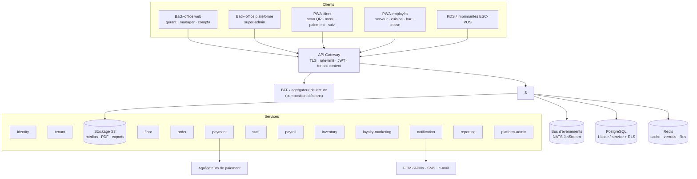

# RESTO-HUB — Architecture logicielle

> Version 0.1 — 23 novembre 2026
> Périmètre : fondations (architecture, contrats d'API, design system, page de démonstration).
> **Aucun service métier n'est implémenté à ce stade** : chaque service est spécifié ici, prêt à être codé sur demande.

---

## 1. Contexte et objectifs

RESTO-HUB est une plateforme SaaS multi-établissements de gestion pour restaurants et bars,
conçue pour le marché ouest-africain (Togo en priorité). Elle réunit dans un seul produit :

- le **pilotage** de l'établissement (plan de salle, commandes, caisse, stocks, équipe, paie) ;
- **l'espace client** mobile (PWA) : menu QR, commande, paiement mobile money, suivi temps réel ;
- le **back-office plateforme** (validation KYC, abonnements, commissions, litiges, supervision).

Contraintes structurantes :

| Contrainte        | Décision                                                                                     |
| ----------------- | -------------------------------------------------------------------------------------------- |
| Devise par défaut | **XOF** (FCFA, montants entiers, aucune décimale)                                            |
| Langues           | **FR** par défaut, **EN** livré, architecture i18n extensible                                |
| Contexte terrain  | réseau instable, écrans sombres, usage à une main, bruit                                     |
| Paiements         | TMoney, Moov Money, CinetPay, PayDunya, FedaPay, PayGate, Stripe (option)                    |
| Conformité        | loi togolaise n° 2019-014 + principes RGPD ; PCI DSS via prestataires (aucune carte stockée) |
| Charge cible v1   | 500 établissements, 10 000 utilisateurs simultanés, p95 < 500 ms, cuisine < 2 s              |
| Disponibilité     | 99,9 % mensuel, sauvegardes quotidiennes, rétention 30 jours                                 |

---

## 2. Principes d'architecture

1. **API-first** : chaque service expose un contrat versionné (`/v1`) documenté en OpenAPI 3.1.
2. **Base de données par service** : un service ne lit ni n'écrit jamais dans la base d'un autre.
   Toute donnée distante passe par l'API du service propriétaire ou par un événement.
3. **Événements asynchrones** : couplage faible via un bus d'événements (NATS JetStream),
   publication garantie par le patron **outbox transactionnel**.
4. **Multi-tenant strict** : `tenant_id` sur toute entité métier, filtré côté serveur,
   doublé d'une **Row-Level Security** PostgreSQL.
5. **Idempotence** : toute mutation financière ou toute consommation d'événement est idempotente
   (`Idempotency-Key`, tables de déduplication, UUID fournis par le client).
6. **Sécurité par défaut** : moindre privilège, RBAC à permissions fines, audit immuable,
   secrets externalisés, webhooks signés.
7. **Contrats explicites** : entrées/sorties documentées, erreurs normalisées, tests de contrat
   et tests d'isolation inter-établissements dans la CI.
8. **Offline-first côté terrain** : file de synchronisation locale, identifiants générés client,
   réconciliation idempotente.

---

## 3. Vue d'ensemble



**Flux de lecture** : les écrans qui agrègent plusieurs domaines (tableau de bord gérant)
passent par le **BFF**, qui appelle les API avec le jeton de l'utilisateur et compose la réponse.
Aucune jointure inter-bases n'est autorisée.

**Flux d'écriture** : le client écrit dans le service propriétaire. Les effets de bord
(cuisine, fidélité, reporting, notifications) sont déclenchés par événements.

---

## 4. Stack technique

| Couche            | Choix                                                                    | Justification                                      |
| ----------------- | ------------------------------------------------------------------------ | -------------------------------------------------- |
| Services backend  | **NestJS 11 / Node.js 22 / TypeScript**                                  | modularité, DI, validation, WebSocket natif        |
| Base de données   | **PostgreSQL 16**, une base par service, RLS                             | ACID pour paiements/paie, isolation                |
| ORM / migrations  | **Prisma** + migrations SQL brutes (policies RLS)                        | typage fort, SQL maîtrisé pour RLS                 |
| Bus d'événements  | **NATS JetStream**                                                       | léger, persistant, ack/DLQ, adapté à 500 tenants   |
| Jobs & files      | **BullMQ sur Redis**                                                     | relances, exports, paie mensuelle, notifications   |
| Cache / verrous   | **Redis**                                                                | sessions, verrous de table, rate-limit, cache menu |
| Temps réel        | **Socket.IO** (rooms par tenant/canal)                                   | plan de salle, KDS, suivi client                   |
| Stockage fichiers | **S3 compatible** + URL signées                                          | photos menu, logos, bulletins PDF, exports         |
| Recherche         | **PostgreSQL full-text** puis **Meilisearch** si volume                  | simplicité d'abord                                 |
| Web               | **React 18 + TypeScript + Vite**, design system maison                   | back-office, PWA client et employés                |
| PWA               | **Workbox** (cache menu/plan de salle, file offline)                     | terrain à réseau instable                          |
| Mobile stores     | wrapper **Capacitor** des PWA (phase 2)                                  | un seul codebase UI                                |
| PDF               | rendu HTML → PDF côté service (Chromium headless)                        | bulletins, rapports, reçus                         |
| Observabilité     | **OpenTelemetry**, Prometheus/Grafana, Sentry, logs structurés           | SLO et diagnostic                                  |
| Conteneurisation  | **Docker**, Kubernetes (ou ECS), Nginx/Ingress                           | scalabilité horizontale                            |
| CI/CD             | GitHub Actions : lint, tests, contrats, isolation, e2e, SAST, image scan | qualité continue                                   |

---

## 5. Conventions d'API

### 5.1 Format

- Base : `https://api.restohub.tg/v1` ; services internes : `http://<service>.svc.cluster.local/v1`.
- JSON **camelCase** (snake_case en base). Dates ISO 8601 UTC (`2026-11-23T18:30:00Z`).
- Montants : entier en **XOF** (`amount: 4500`, `currency: "XOF"`), jamais de flottant.
- Enveloppe de succès :

```json
{ "data": {}, "meta": { "requestId": "req_01J...", "cursor": "..." } }
```

- Erreur normalisée :

```json
{
  "error": {
    "code": "TABLE_ALREADY_OCCUPIED",
    "message": "La table LOME01-SAL-014 est déjà occupée.",
    "details": [{ "field": "tableId", "issue": "occupied" }],
    "traceId": "4f1c..."
  }
}
```

- Codes HTTP : 200/201, 204, 400 (validation), 401, 403 (permission), 404 (y compris
  **ressource d'un autre tenant** — jamais 403 pour ne pas divulguer son existence),
  409 (conflit/état), 422 (règle métier), 429, 500.

### 5.2 En-têtes

| En-tête                       | Usage                                                           |
| ----------------------------- | --------------------------------------------------------------- |
| `Authorization: Bearer <jwt>` | accès utilisateur ou service (client credentials)               |
| `X-Tenant-Id`                 | tenant actif ; **doit** correspondre aux claims du jeton        |
| `Idempotency-Key`             | obligatoire sur POST financiers (paiement, remboursement, paie) |
| `X-Request-Id`                | corrélation ; propagé dans les événements et les logs           |
| `If-Match`                    | contrôle de version optimiste sur les mutations sensibles       |

### 5.3 Pagination, filtres, tri

`GET /v1/orders?status=paid&from=2026-11-01&to=2026-11-30&sort=-createdAt&limit=50&cursor=...`
Réponse : `meta.cursor` (opaque). Maximum 200 éléments. Filtres par période, site, statut.

### 5.4 Permissions (RBAC)

Format : `resource:action[:scope]` — ex. `order:view`, `order:cancel`, `payment:refund`,
`report:export`, `staff:payroll:approve`, `tenant:settings:update`, `platform:tenant:approve`.

Rôles de base livrés : `platform_admin`, `owner` (gérant principal), `deputy_manager`,
`floor_manager`, `server`, `cashier`, `cook`, `bartender`, `delivery`, `accountant`.
Les rôles sont **personnalisables** par le gérant (staff-service + identity-service).

Le jeton JWT contient : `sub`, `tenantId`, `groupId`, `roles[]`, `permissions[]` (compressées),
`sessionId`, `amr[]` (facteurs), `exp`, `iat`, `jti`. Un jeton est révoqué via `sessionId`.

### 5.5 Versioning & évolution

- URL versionnée (`/v1`) pour les ruptures majeures ; évolutions additives sans changement d'URL.
- Événements versionnés (`OrderCreated.v1`), schémas JSON Schema dans un registre.
- Dépréciation : en-tête `Deprecation` + `Sunset`, fenêtre minimale de 90 jours.

---

## 6. Multi-tenant et sécurité

### 6.1 Modèle de tenancy

- `tenant` = **un établissement** (restaurant, bar, terrasse). `tenant_id` (UUID) identifie l'espace.
- `group` = un groupe multi-sites (même gérant principal, facturation consolidée).
- Toutes les entités métier portent `tenant_id` ; les entités plateforme (`platform_admin`,
  `plan`, `country_config`) sont globales et explicitement hors tenant.
- Jeton et requêtes : le tenant actif est **toujours** dérivé du jeton vérifié,
  `X-Tenant-Id` ne sert qu'à sélectionner un site autorisé du groupe.

### 6.2 Filtrage côté serveur + RLS

Chaque service ouvre une transaction et pose le contexte :

```sql
BEGIN;
SET LOCAL app.tenant_id = '6f0c2a7e-...';
SET LOCAL app.actor_id  = '9a1d...';
-- la policy RLS filtre automatiquement toutes les tables métier
SELECT * FROM orders WHERE status = 'open';
COMMIT;
```

```sql
ALTER TABLE orders ENABLE ROW LEVEL SECURITY;
CREATE POLICY tenant_isolation ON orders
  USING (tenant_id = current_setting('app.tenant_id')::uuid)
  WITH CHECK (tenant_id = current_setting('app.tenant_id')::uuid);
```

Garde-fous complémentaires :

- middleware NestJS qui exige `app.tenant_id` avant toute requête métier ;
- repository de base qui injecte `tenant_id` et refuse une requête sans contexte ;
- **aucun rôle applicatif `BYPASSRLS`** ;
- le super-admin plateforme n'accède aux données d'un tenant que via une route plateforme
  explicite, journalisée, et jamais via les API métier.

### 6.3 Tests d'isolation automatiques (obligatoires en CI)

Pour **chaque** endpoint exposé, un test d'accès croisé :

1. seed de deux tenants A et B avec des ressources de même type ;
2. jeton A tente `GET/PATCH/DELETE` sur l'identifiant d'une ressource de B ;
3. attendu : **404** (ou 403 uniquement pour une permission manquante dans A), jamais 200 ;
4. tentative d'injection `tenant_id=B` dans le corps ou les filtres → ignorée ou 400 ;
5. tentative de jeton A avec `X-Tenant-Id: B` → 403.

Les tests couvrent aussi les événements : un événement de B ne doit jamais apparaître dans
une room temps réel ou un export de A.

### 6.4 Journal d'audit immuable

- `audit_log` **append-only** (aucun UPDATE/DELETE, rôle DB dédié), dans staff-service.
- Chaîne de hachage : `hash = sha256(prev_hash || canonical_payload)` ; export quotidien
  WORM vers S3 avec horodatage ; vérification d'intégrité planifiée.
- Événements audités : annulations, remises, remboursements, changements de prix, clôtures
  de caisse, opérations de paie, modifications de rôles, accès super-admin, exports de données.
- Chaque entrée : acteur, tenant, action, ressource, avant/après (diff), IP, user-agent,
  requestId, horodatage. Aucun secret ni numéro de carte.

### 6.5 Sécurité des paiements

- **Aucun numéro de carte** n'est stocké, transmis ou journalisé : formulaires hébergés ou
  tokenisation des prestataires certifiés PCI DSS (SAQ-A).
- Webhooks : HMAC-SHA256 sur le corps brut + en-tête de signature + horodatage (fenêtre 5 min) ;
  rejet si signature invalide ; déduplication par `provider_event_id` ; réponse 2xx rapide puis
  traitement asynchrone idempotent.
- Secrets : variables d'environnement injectées depuis Vault/KMS ; rotation ; jamais dans le code,
  les images ou les logs. Clés par environnement.
- Anti-fraude : plafonds par transaction/jour, vélocité, listes de blocage, score d'anomalie,
  3-D Secure sur cartes, blocage temporaire + revue.

### 6.6 Conformité (loi 2019-014, RGPD)

- Minimisation : seules les données nécessaires (identité, contact, historique de commande).
- Base légale et consentement explicite pour le marketing ; désinscription en un clic.
- Droits : export et suppression (anonymisation) via `platform-admin` / self-service,
  délais documentés ; données de facturation conservées selon obligations légales.
- Rétention : logs techniques 90 jours, audit 5 ans, données clients selon politique publiée.
- Chiffrement TLS 1.3 en transit, AES-256 au repos, Argon2id pour les mots de passe,
  MFA obligatoire pour les gérants et super-admins.
- Hébergement avec région proche des utilisateurs ; registre des traitements ; DPO désigné.

---

## 7. Catalogue des services

| #   | Service           | Responsabilité                                     | Base           | Publie (réel)                                                                                                                                                                                                                     | Consomme (réel)                                                                                                                                                                                                 |
| --- | ----------------- | -------------------------------------------------- | -------------- | --------------------------------------------------------------------------------------------------------------------------------------------------------------------------------------------------------------------------------- | --------------------------------------------------------------------------------------------------------------------------------------------------------------------------------------------------------------- |
| 1   | identity          | auth, OTP, sessions, MFA, RBAC                     | `identity`     | — (sessions, aucun événement métier)                                                                                                                                                                                              | TenantApproved, TenantSuspended                                                                                                                                                                                 |
| 2   | tenant            | établissements, KYC, branding, abonnements         | `tenant`       | TenantApplicationSubmitted/InfoRequested/Rejected, TenantApproved, TenantSuspended, TenantReactivated, TenantBrandingUpdated, SubscriptionInvoicePaid                                                                             | SubscriptionInvoicePaid                                                                                                                                                                                         |
| 3   | catalog           | produits, menus, prix, promos                      | `catalog`      | CatalogItemUpdated                                                                                                                                                                                                                | —                                                                                                                                                                                                               |
| 4   | floor             | zones, tables, QR, réservations, temps réel        | `floor`        | TableStatusChanged, ReservationCreated, ReservationStatusChanged, FloorLayoutUpdated, FloorOrderTransferred, FloorTablesMerged, FloorTablesSplit                                                                                  | —                                                                                                                                                                                                               |
| 5   | order             | panier, commandes, KDS, POS, caisse                | `order`        | OrderCreated, OrderStatusChanged, OrderPaid                                                                                                                                                                                       | —                                                                                                                                                                                                               |
| 6   | payment           | agrégateur, portefeuille, commissions, grand livre | `payment`      | PaymentInitiated, PaymentConfirmed, PaymentFailed, PaymentCancelled, RefundIssued, DisputeOpened, DisputeResolved, SettlementRequested, SettlementPaid, ReconciliationCompleted, DisbursementPaid, SplitCompleted, TipDistributed | OrderPaid                                                                                                                                                                                                       |
| 7   | staff             | employés, plannings, pointage, audit               | `staff`        | StaffInvited, StaffActivated, StaffUpdated, AttendanceClocked, ShiftPublished, ShiftSwapDecided, LeaveDecided                                                                                                                     | OrderPaid, TipDistributed                                                                                                                                                                                       |
| 8   | payroll           | paie, bulletins, paiement groupé 2 niveaux         | `payroll`      | PayrollRunCreated, PayrollSettingsUpdated, PayrollApproved, PayrollPaid, PayrollPaymentFailed, PayslipsSent                                                                                                                       | StaffUpdated                                                                                                                                                                                                    |
| 9   | inventory         | stocks, recettes, pertes, fournisseurs             | `inventory`    | StockBelowThreshold, StockDepleted, StockReplenished, WasteRecorded                                                                                                                                                               | OrderPaid                                                                                                                                                                                                       |
| 10  | loyalty-marketing | fidélité, promos, campagnes, avis                  | `loyalty`      | LoyaltyPointsEarned, LoyaltyRewardRedeemed, PromoCodeRedeemed, PromotionCreated, CampaignSent, ReviewSubmitted, ReviewReplied, ReviewModerated                                                                                    | OrderPaid                                                                                                                                                                                                       |
| 11  | notification      | push, SMS, e-mail, temps réel                      | `notification` | SmsDeliveryReported                                                                                                                                                                                                               | OrderCreated, OrderPaid, PaymentFailed, TableStatusChanged, ReservationCreated, StockBelowThreshold, StockDepleted, CampaignSent, PayrollApproved, PayrollPaid                                                  |
| 12  | reporting         | entrepôt de lecture, KPI, exports                  | `reporting`    | ReportExported                                                                                                                                                                                                                    | OrderPaid, PaymentFailed, RefundIssued, ReservationCreated, ReviewSubmitted, ReviewModerated, PayrollPaid                                                                                                       |
| 13  | platform-admin    | supervision, litiges, paramètres globaux           | `platform`     | PlatformSettingsUpdated                                                                                                                                                                                                           | TenantApplicationSubmitted/Rejected, TenantApproved, TenantSuspended, TenantReactivated, SubscriptionInvoicePaid, PaymentConfirmed, PaymentFailed, RefundIssued, DisputeOpened, DisputeResolved, SettlementPaid |

> Ces listes sont issues du code (`services/*/src`, hors tests) et recoupées par les tests de
> `packages/shared-contracts` : chaque événement imposé doit être publié par au moins un service.

Ports de développement (convention) : identity 4001, tenant 4002, catalog 4003, floor 4004,
order 4005, payment 4006, staff 4007, payroll 4008, inventory 4009, loyalty 4010,
notification 4011, reporting 4012, platform-admin 4013. Gateway 8080.

Chaque service possède dans son dossier `services/<service>/README.md` sa fiche de contrat
et un `openapi.yaml` (ajouté au moment de l'implémentation du service).

---

## 8. Spécification détaillée des services

> Convention : `T` = tenant actif (dérivé du jeton). Les chemins sont relatifs à `/v1`.
> `admin` = permission plateforme. Toute réponse de liste est paginée par curseur.

### 8.1 identity-service

**Responsabilités**

- Inscription/connexion client : téléphone + OTP SMS, e-mail + mot de passe, Google, Apple.
- Sessions (access + refresh rotatif), révocation, appareils.
- MFA (TOTP) obligatoire pour gérants et super-admins ; step-up avant opérations sensibles.
- RBAC : rôles, permissions, affectations, invitations d'employés.
- Émission des jetons signés (RS256) avec claims tenant/groupe/rôles/permissions.

**Entités** : `User` (id, tenant_id nullable pour clients multi-établissements, phone, email,
password_hash, status, locale, mfa_enabled), `SocialIdentity`, `OtpChallenge` (hash, expires,
attempts), `Session` (refresh_hash, device, ip, revoked_at), `MfaFactor`, `Role` (tenant_id,
name, is_system), `Permission` (global catalogue), `RolePermission`, `UserRole` (scope group/site),
`Invitation` (token_hash, role, expires), `Consent`.

**API**

| Méthode | Chemin                                        | Entrée → Sortie                                   | Permission                              |
| ------- | --------------------------------------------- | ------------------------------------------------- | --------------------------------------- |
| POST    | `/auth/register`                              | phone/email + locale → user + challenge OTP       | public                                  |
| POST    | `/auth/otp/request`                           | phone, purpose → `{ expiresIn }` (jamais le code) | public, rate-limité                     |
| POST    | `/auth/otp/verify`                            | phone, code, device → tokens                      | public                                  |
| POST    | `/auth/login`                                 | email, password, device → tokens ou `mfaRequired` | public                                  |
| POST    | `/auth/social/:provider`                      | idToken Google/Apple → tokens                     | public                                  |
| POST    | `/auth/mfa/enroll`                            | → secret + otpauth URI                            | authentifié                             |
| POST    | `/auth/mfa/verify`                            | code → tokens / activation                        | authentifié                             |
| POST    | `/auth/step-up`                               | code MFA → `stepUpToken` (5 min)                  | authentifié                             |
| POST    | `/auth/refresh`                               | refresh token → nouveaux tokens (rotation)        | refresh                                 |
| POST    | `/auth/logout`                                | → 204, session révoquée                           | authentifié                             |
| GET     | `/auth/me`                                    | → profil + rôles + permissions effectives         | authentifié                             |
| GET     | `/users`                                      | filtres rôle/statut → liste                       | `staff:view`                            |
| POST    | `/invitations`                                | email/phone, roleId, siteIds → invitation envoyée | `staff:invite`                          |
| POST    | `/invitations/:token/accept`                  | mot de passe / OTP → compte actif                 | public                                  |
| GET     | `/roles` · POST `/roles` · PATCH `/roles/:id` | nom, permissions → rôle                           | `staff:role:manage`                     |
| POST    | `/users/:id/roles`                            | roleId, scope → affectation                       | `staff:role:assign`                     |
| DELETE  | `/sessions/:id`                               | → 204                                             | propriétaire ou `staff:security:manage` |
| GET     | `/internal/users/:id`                         | → identité minimale (service-à-service)           | mTLS + scope interne                    |
| POST    | `/internal/introspect`                        | jeton → claims validés                            | interne                                 |

**Événements publiés** : `UserRegistered`, `UserInvited`, `UserRoleChanged`, `MfaEnabled`,
`SessionRevoked`, `PasswordChanged`.
**Événements consommés** : `TenantSuspended` (révoque toutes les sessions du tenant),
`EmployeeOffboarded` (révoque l'accès), `TenantApproved` (active les comptes gérant).

**Notes** : OTP 6 chiffres, 5 minutes, 5 tentatives max, anti-enumération ; verrouillage
progressif ; Argon2id ; refresh tokens rotatifs avec détection de réutilisation.

---

### 8.2 tenant-service

**Responsabilités**

- Candidature d'établissement, KYC/KYB léger, validation par le super-admin.
- Espace dédié (slug/sous-domaine), paramètres, horaires, devise, taxes, langues.
- Branding (logo, couleurs) de l'espace client.
- Multi-sites (groupes), abonnements SaaS (Starter, Pro, Entreprise), essai, facturation,
  suspension pour impayé.
- Source de vérité des **droits** (entitlements) par plan, exposée aux autres services.

**Entités** : `Tenant` (id, group_id, slug, legal_name, tax_id/RCCM, address, phone, status
[draft|pending_kyc|active|suspended], plan_id, currency, locales, timezone), `Group`,
`KycDocument` (type, file_key, status, reviewed_by), `Branding` (logo_key, primary_color,
secondary_color, welcome_text), `OpeningHours`, `TaxProfile` (VAT rates, fiscal rules),
`Subscription` (plan, trial_ends_at, status, billing_cycle), `Plan` (limits, commission rates),
`Invoice` (SaaS), `UsageCounter`.

**API**

| Méthode | Chemin                                       | Entrée → Sortie                                                        | Permission                       |
| ------- | -------------------------------------------- | ---------------------------------------------------------------------- | -------------------------------- |
| POST    | `/tenants`                                   | raison sociale, RCCM, adresse, contact, pièces → dossier `pending_kyc` | public                           |
| GET     | `/tenants/:id`                               | → fiche + branding + statut                                            | `tenant:view`                    |
| PATCH   | `/tenants/:id`                               | champs modifiables → fiche                                             | `tenant:settings:update`         |
| POST    | `/tenants/:id/kyc`                           | documents (URL signées) → statut                                       | `tenant:settings:update`         |
| GET     | `/tenants/:id/branding`                      | → logo, couleurs, textes                                               | `tenant:view` / public si active |
| PUT     | `/tenants/:id/branding`                      | logo, couleurs (validées AA) → branding                                | `tenant:settings:update`         |
| GET/PUT | `/tenants/:id/settings`                      | devise, langues, taxes, horaires                                       | `tenant:settings:update`         |
| POST    | `/groups` · POST `/groups/:id/tenants`       | nom, sites → groupe                                                    | `tenant:group:manage`            |
| GET     | `/plans`                                     | → plans, limites, commissions                                          | public                           |
| POST    | `/tenants/:id/subscription`                  | planId, cycle → abonnement                                             | `tenant:billing:manage`          |
| POST    | `/tenants/:id/subscription/change`           | planId → prorata                                                       | `tenant:billing:manage`          |
| GET     | `/invoices`                                  | période → factures SaaS                                                | `tenant:billing:manage`          |
| GET     | `/admin/tenants`                             | statut, recherche → file de validation                                 | `platform:tenant:view`           |
| POST    | `/admin/tenants/:id/approve`                 | → tenant actif + onboarding                                            | `platform:tenant:approve`        |
| POST    | `/admin/tenants/:id/reject`                  | motif → rejet notifié                                                  | `platform:tenant:approve`        |
| POST    | `/admin/tenants/:id/suspend` · `/reactivate` | motif → statut                                                         | `platform:tenant:manage`         |
| GET     | `/internal/tenants/:id/entitlements`         | → limites et commissions effectives                                    | interne                          |

**Événements publiés** : `TenantApplied`, `TenantApproved`, `TenantRejected`, `TenantSuspended`,
`TenantReactivated`, `TenantBrandingUpdated`, `SubscriptionChanged`, `InvoiceIssued`, `InvoicePaid`.
**Événements consommés** : `PaymentSucceeded` (facture SaaS), `PaymentFailed` (relance puis
suspension), `PayrollApproved` (mise à jour des limites d'usage, sans données de paie).

**Notes** : la validation KYC est manuelle (super-admin) ; l'approbation déclenche la création
de l'espace, des rôles par défaut et d'un catalogue de démonstration. Branding : contraste
AA vérifié côté serveur avant enregistrement.

---

### 8.3 catalog-service

**Responsabilités**

- Catégories, produits, variantes, groupes d'options et suppléments.
- Menus composés (formules), sections, ordre d'affichage, canaux (sur place, emporter, livraison).
- Allergènes, médias, disponibilité, rupture manuelle (86).
- Prix par plage horaire (happy hour), taxes rattachées, promotions (remises produit/menu).
- Publication de menus versionnés (cache CDN invalidé).

**Entités** : `Category` (name, position, channel), `Product` (name, description, image_key,
category_id, tax_rate, is_active, allergens[]), `Variant` (name, price_delta),
`OptionGroup` (min/max, required), `Option` (name, price_delta), `Menu` (name, channels,
status draft/published, version), `MenuSection`, `MenuItem` (product/variant refs, price override),
`PriceSchedule` (days, start/end time, price, happy_hour), `Promotion` (type, scope, value,
starts/ends, channels), `ProductAvailability` (channel, is_available, reason).

**API**

| Méthode  | Chemin                                         | Entrée → Sortie                          | Permission                        |
| -------- | ---------------------------------------------- | ---------------------------------------- | --------------------------------- |
| GET/POST | `/categories` · PATCH/DELETE `/categories/:id` | nom, position → catégorie                | `catalog:view` / `catalog:manage` |
| GET/POST | `/products` · PATCH `/products/:id`            | produit complet (variantes, options)     | `catalog:view` / `catalog:manage` |
| DELETE   | `/products/:id`                                | soft delete + événement                  | `catalog:manage`                  |
| POST     | `/products/:id/availability`                   | canal, dispo, motif → 86                 | `catalog:availability`            |
| GET/POST | `/menus` · PATCH `/menus/:id`                  | sections, items → menu brouillon         | `catalog:manage`                  |
| POST     | `/menus/:id/publish`                           | → version publiée + cache invalidé       | `catalog:publish`                 |
| GET      | `/public/menu?tenant=:slug`                    | canal, langue → menu public (cache)      | public                            |
| GET/POST | `/price-schedules`                             | plage horaire, prix → planning tarifaire | `catalog:price:manage`            |
| GET/POST | `/promotions` · PATCH `/promotions/:id`        | type, valeur, période → promotion        | `catalog:promo:manage`            |
| GET      | `/products/:id/price?at=`                      | date/heure, canal → prix effectif        | `catalog:view`                    |
| POST     | `/imports`                                     | CSV produits → job d'import + rapport    | `catalog:import`                  |
| GET      | `/internal/products?ids=`                      | → prix et disponibilité à jour           | interne                           |

**Événements publiés** : `ProductCreated`, `ProductUpdated`, `PriceChanged`, `ProductUnavailable`,
`MenuPublished`, `PromotionActivated`, `PromotionEnded`.
**Événements consommés** : `TenantApproved` (catalogue initial), `StockBelowThreshold`
(proposition de mise en 86), `InventoryItemDepleted`.

**Notes** : le prix effectif est calculé côté serveur (plage horaire > promo > prix de base) ;
jamais confiance au prix envoyé par le client. Toute modification de prix est auditée.

---

### 8.4 floor-service

**Responsabilités**

- Zones (salle, terrasse, VIP, bar, étage) et plan de salle (éditeur glisser-déposer).
- Tables/places avec identifiant structuré unique `ETAB-ZONE-NUMERO` (ex. `LOME01-TER-014`),
  unicité garantie par contrainte en base **au sein du tenant**.
- QR code unique par table, génération/impression, résolution publique.
- Statuts temps réel : `free`, `reserved`, `occupied`, `bill_requested`, `cleaning`, `out_of_service`.
- Réservations (créneaux, capacité, liste d'attente, rappels, no-show), fusion/scission,
  transfert de table.
- Diffusion temps réel (Socket.IO) vers salle, caisse, cuisine et clients.

**Entités** : `Zone` (name, floor, color, position), `Table` (code unique, zone_id, capacity,
shape, x/y/rotation, status, current_session_id, version), `TableSession` (opened_at, guests,
server_id, closed_at), `TableStatusEvent` (from, to, actor, reason), `QrCode` (table_id, token,
version), `Reservation` (customer, party_size, slot_start, duration, status, table_id,
source, notes, reminders_sent), `WaitlistEntry` (position, quoted_minutes).

**API**

| Méthode  | Chemin                                                          | Entrée → Sortie                                 | Permission                    |
| -------- | --------------------------------------------------------------- | ----------------------------------------------- | ----------------------------- |
| GET/POST | `/zones` · PATCH/DELETE `/zones/:id`                            | nom, plan → zone                                | `floor:view` / `floor:manage` |
| GET      | `/floor`                                                        | → snapshot complet (zones, tables, sessions)    | `floor:view`                  |
| PUT      | `/floor/layout`                                                 | positions/tailles des tables → plan             | `floor:layout:manage`         |
| POST     | `/tables`                                                       | code, zone, capacité, type → table              | `floor:manage`                |
| PATCH    | `/tables/:id`                                                   | capacité, zone, statut manuel                   | `floor:manage`                |
| PATCH    | `/tables/:id/status`                                            | `{ status, reason?, version }` → statut + event | `floor:status`                |
| POST     | `/tables/:id/qr/rotate`                                         | → nouveau token QR (ancien invalide)            | `floor:qr:manage`             |
| GET      | `/public/qr/:token`                                             | → tenant + table + menu URL                     | public, rate-limité           |
| POST     | `/tables/:id/transfer`                                          | orderId, targetTableId → commande déplacée      | `floor:manage`                |
| POST     | `/tables/:id/merge` · `/split`                                  | tables, sens → fusion/scission                  | `floor:manage`                |
| GET/POST | `/reservations` · PATCH `/reservations/:id`                     | créneau, couverts, table → réservation          | `floor:reservation:manage`    |
| GET      | `/reservations/availability?date=&party=`                       | → créneaux libres                               | `floor:view` / public         |
| POST     | `/reservations/:id/check-in` · `/no-show` · `/cancel`           | → statut                                        | `floor:reservation:manage`    |
| GET      | `/waitlist` · POST `/waitlist/:id/promote`                      | file d'attente → table                          | `floor:manage`                |
| WS       | `/floor` (rooms `t:${tenant}:floor`, `t:${tenant}:reservation`) | events temps réel                               | jeton                         |

**Événements publiés** : `TableStatusChanged`, `TableOpened`, `TableClosed`, `ReservationCreated`,
`ReservationConfirmed`, `ReservationCancelled`, `ReservationNoShow`, `WaitlistPromoted`.
**Événements consommés** : `OrderCreated` (ouvre la session/table occupée), `OrderPaid`
(→ `bill_requested` puis `cleaning` selon config), `OrderCancelled` (libération),
`PaymentFailed` (maintien occupé), `TenantApproved`.

**Notes** : transitions de statut validées par machine à états (pas de `free → cleaning`) ;
verrou Redis par table pour éviter les doubles affectations ; transfert de commande via
order-service (API), pas d'écriture croisée.

---

### 8.5 order-service

**Responsabilités**

- Panier client (persistant, multi-appareils), commandes sur place / à emporter / livraison /
  précommande, ajouts successifs sur une même table.
- Lignes, options, notes cuisine, allergies, découpage par poste (cuisine, bar).
- Workflow de statuts et machine à états ; KDS (écrans production) et tickets ESC/POS.
- Caisse (POS) : ouverture/clôture de shift, encaissements multi-modes, remises, annulations
  motivées, mouvements de caisse, reçus fiscaux numérotés séquentiellement.
- Mode hors ligne et synchronisation idempotente.
- Calcul des totaux côté serveur (remises, taxes, pourboire, commission).

**Entités** : `Cart` (owner, table_id, channel, status), `CartLine` (product snapshot, qty,
options, notes), `Order` (number séquentiel par tenant, channel, table_id, customer_id,
status, totals [subtotal, discount, tax, tip, total], payment_status, version, client_uuid),
`OrderLine` (snapshot nom/prix, qty, station, status), `OrderLineOption`,
`OrderStatusHistory`, `KitchenTicket` (station, status, printed_at), `PosShift` (opened_by,
opening_float, closing_count, variance), `CashMovement`, `Discount` (type, value, reason,
approved_by), `FiscalReceipt` (sequential number, hash), `OutboxEvent`.

**Workflow commande** : `draft → confirmed → sent → preparing → ready → served → paid → closed`
(et `cancelled` avec motif + permission). Chaque transition auditée.

**API**

| Méthode      | Chemin                              | Entrée → Sortie                                         | Permission              |
| ------------ | ----------------------------------- | ------------------------------------------------------- | ----------------------- |
| POST         | `/carts`                            | channel, tableId/customerId → panier                    | `order:create` / client |
| POST         | `/carts/:id/lines`                  | productId, qty, options, notes → ligne + totaux         | idem                    |
| PATCH/DELETE | `/carts/:id/lines/:lineId`          | qty, options → totaux                                   | idem                    |
| POST         | `/carts/:id/promo`                  | code → remise validée                                   | idem                    |
| POST         | `/orders`                           | panier, table/canal, clientUuid → commande confirmée    | `order:create`          |
| GET          | `/orders`                           | statut, période, table, serveur → liste                 | `order:view`            |
| GET          | `/orders/:id`                       | → commande complète + timeline                          | `order:view`            |
| PATCH        | `/orders/:id/status`                | transition + motif → commande                           | selon transition        |
| POST         | `/orders/:id/discount`              | type, valeur, motif → remise auditée                    | `order:discount`        |
| POST         | `/orders/:id/cancel`                | motif, stepUpToken → annulation auditée                 | `order:cancel`          |
| POST         | `/orders/:id/pay`                   | mode, montant, split → intent de paiement               | `order:pay` / client    |
| POST         | `/orders/:id/refund`                | montant, motif → remboursement (via payment)            | `payment:refund`        |
| GET          | `/kds/tickets?station=`             | station, statut → tickets triés                         | `kds:view`              |
| PATCH        | `/kds/tickets/:id/bump`             | → ticket avancé (preparing/ready)                       | `kds:operate`           |
| GET          | `/pos/shifts/current`               | → shift + fond de caisse                                | `pos:operate`           |
| POST         | `/pos/shifts/open` · `/close`       | fond initial / comptage final → écart                   | `pos:operate`           |
| POST         | `/pos/cash-movements`               | entrée/sortie, motif → mouvement                        | `pos:cash:manage`       |
| GET          | `/pos/receipts/:id`                 | → reçu fiscal (PDF)                                     | `pos:view`              |
| POST         | `/orders/sync`                      | lot d'ordres offline (client_uuid) → résultats par item | `order:create`          |
| GET          | `/internal/orders/:id`              | → commande (service-à-service)                          | interne                 |
| GET          | `/internal/orders?tableId=&status=` | → commandes de la table                                 | interne                 |

**Événements publiés** : `OrderCreated`, `OrderConfirmed`, `OrderSentToKitchen`,
`OrderItemReady`, `OrderServed`, `OrderPaid`, `OrderCancelled`, `OrderRefunded`,
`TableBillRequested`, `PosShiftClosed`, `ReceiptIssued`.
**Événements consommés** : `PaymentSucceeded` (→ `OrderPaid`), `PaymentFailed`,
`PaymentRefunded`, `ProductUnavailable` (blocage ligne), `TableStatusChanged` (synchro plan).

**Notes** : numérotation des commandes et reçus par tenant, séquence PostgreSQL ; la TVA
provient de tenant-service (cache local avec TTL) ; tout total est recalculé côté serveur.
`OrderPaid` n'est publié **qu'après** confirmation `PaymentSucceeded` (ou encaissement espèces
validé par un caissier).

---

### 8.6 payment-service (agrégateur)

**Responsabilités**

- Couche d'abstraction (pattern adapter) au-dessus des prestataires : TMoney, Moov Money/Flooz,
  CinetPay, PayDunya, FedaPay, PayGate, Stripe (option cartes internationales).
- Routage intelligent (moyen de paiement, coût, disponibilité, pays) + bascule automatique.
- Cycle complet : initiation, confirmation, échec, expiration, annulation, remboursement
  partiel/total, paiement fractionné, pourboires.
- Webhooks signés et idempotents.
- Portefeuille marchand par établissement, reversements (instantané ou par lots), commissions
  par plan et par moyen de paiement, frais prestataires.
- Réconciliation automatique, journal comptable en partie double, exports, anti-fraude.

**Entités** : `PaymentIntent` (order_id, amount, currency, method, provider, status, client_secret,
expires_at, metadata), `Transaction` (provider_ref, status, fee, net, raw_ref), `Refund`,
`ProviderAccount` (tenant_id, provider, credentials_ref [coffre], enabled, priority),
`RoutingRule` (method, country, conditions, provider order), `WebhookEvent` (provider,
provider_event_id unique, signature_valid, payload_hash, processed_at), `Wallet` (tenant_id,
available, pending, reserved), `WalletEntry`, `Payout` (batch, status, items), `CommissionRule`
(plan, method, rate, fixed), `CommissionEntry`, `LedgerAccount` (code, type), `LedgerEntry`
(debit/credit, amount, ref, entry_group), `ReconciliationRun`, `ReconciliationMatch`,
`FraudRule`, `FraudEvent`, `SplitShare`, `TipAllocation`.

**Machine à états** : `created → requires_action → processing → succeeded | failed | expired`
puis `partially_refunded → refunded`.

**Contrat adaptateur** (extrait) :

```ts
interface PaymentProviderAdapter {
  readonly key: 'tmoney' | 'moov' | 'cinetpay' | 'paydunya' | 'fedapay' | 'paygate' | 'stripe';
  supports(method: PaymentMethod, country: string): boolean;
  initiate(input: InitiatePayment): Promise<ProviderInitResult>; // status + redirect/ussd + ref
  capture?(ref: string): Promise<ProviderResult>;
  refund(ref: string, amount: number): Promise<ProviderRefundResult>;
  verifyWebhook(rawBody: Buffer, headers: Record<string, string>): WebhookVerification;
  healthCheck(): Promise<ProviderHealth>;
}
```

**API**

| Méthode | Chemin                                      | Entrée → Sortie                                          | Permission                      |
| ------- | ------------------------------------------- | -------------------------------------------------------- | ------------------------------- |
| POST    | `/payments/intents`                         | orderId, montant, méthode, split → intent + instructions | `payment:initiate` / client     |
| GET     | `/payments/intents/:id`                     | → statut, provider, prochaine action                     | propriétaire / `payment:view`   |
| POST    | `/payments/intents/:id/cancel`              | → annulation                                             | propriétaire / `payment:cancel` |
| POST    | `/webhooks/:provider`                       | corps brut + signature → 2xx rapide                      | public, signature               |
| POST    | `/refunds`                                  | transactionId, montant, motif → remboursement            | `payment:refund`                |
| GET     | `/refunds/:id`                              | → statut                                                 | `payment:view`                  |
| GET     | `/transactions`                             | période, méthode, statut → liste                         | `payment:view`                  |
| GET     | `/wallets/:tenantId`                        | → solde disponible/en attente                            | `wallet:view`                   |
| GET     | `/payouts` · POST `/payouts`                | montant, compte → reversement                            | `wallet:payout`                 |
| GET     | `/commissions`                              | période, plan → commissions                              | `payment:commission:view`       |
| GET     | `/ledger/entries` · `/ledger/trial-balance` | période → grand livre / balance                          | `ledger:view`                   |
| POST    | `/reconciliation/runs`                      | période, provider → exécution                            | `payment:reconcile`             |
| GET     | `/reconciliation/runs/:id`                  | → rapprochement + écarts                                 | `payment:reconcile`             |
| GET/PUT | `/providers` · `/providers/:key`            | activation, priorité, compte                             | `platform:payment:manage`       |
| GET/PUT | `/routing-rules`                            | règles de routage                                        | `platform:payment:manage`       |
| GET     | `/fraud/events` · PATCH `/fraud/rules`      | → alertes / règles                                       | `payment:fraud:manage`          |
| POST    | `/tips/:paymentId/allocate`                 | répartition serveurs → allocations                       | `payment:tip:manage`            |
| GET     | `/internal/payments/:id`                    | → statut et montants (inter-service)                     | interne                         |

**Événements publiés** : `PaymentInitiated`, `PaymentSucceeded`, `PaymentFailed`,
`PaymentExpired`, `RefundSucceeded`, `RefundFailed`, `PayoutSucceeded`, `PayoutFailed`,
`WalletCredited`, `ReconciliationDiscrepancy`, `FraudBlocked`, `CommissionRecorded`.
**Événements consommés** : `OrderCreated` (préparation du contexte de paiement),
`OrderCancelled`, `PayrollApproved` (paiement groupé des salaires), `InvoiceIssued` (abonnement),
`TenantSuspended` (gel des reversements), `ChargebackOpened`.

**Écriture comptable (partie double)** — exemple d'un encaissement de 10 000 XOF,
commission plateforme 2 %, frais prestataire 150 XOF :

| Compte                                 | Débit | Crédit |
| -------------------------------------- | ----- | ------ |
| 511 Prestataire (clearing)             | 9 850 |        |
| 627 Frais prestataire                  | 150   |        |
| 401 Dette établissement (portefeuille) |       | 9 800  |
| 701 Commissions plateforme             |       | 200    |

Chaque opération crée un `entry_group` équilibré (Σ débits = Σ crédits), vérifié en base.

**Notes** : la commission est retenue au moment du crédit du portefeuille ; les reversements
sont idempotents (`Idempotency-Key`) ; la réconciliation compare transactions internes,
relevés prestataires et clôtures de caisse (order-service), et ouvre un litige si écart.

---

### 8.7 staff-service

**Responsabilités**

- Fiches employés, contrats, coordonnées de paiement (mobile money/banque, chiffrées au repos).
- Invitations et cycle de vie (embauche, suspension, départ).
- Plannings, équipes, échanges de shifts, congés et absences.
- Pointage : PIN, QR, géolocalisation optionnelle ; calcul des heures.
- Performances : ventes par serveur, tables servies, pourboires.
- **Journal d'audit immuable** central pour les actions sensibles de tous les services
  (événements `AuditRecorded` consommés).

**Entités** : `Employee` (user_id, tenant_id, names, position, status, photo, hire_date,
payment_method_ref), `EmploymentContract` (type, base_salary, currency, start/end, documents),
`Shift` (date, start/end, role, station, employee_id, status), `ShiftSwap`, `LeaveRequest`,
`Attendance` (clock_in/out, method pin|qr|geo, lat/lng nullable, device, anomaly),
`PerformanceSnapshot` (period, employee_id, sales, tables, tips), `AuditLog` (seq, actor,
action, resource, before/after diff, ip, ua, request_id, prev_hash, hash).

**API**

| Méthode  | Chemin                                           | Entrée → Sortie                                   | Permission                                      |
| -------- | ------------------------------------------------ | ------------------------------------------------- | ----------------------------------------------- |
| GET/POST | `/employees` · PATCH `/employees/:id`            | fiche complète → employé                          | `staff:view` / `staff:manage`                   |
| POST     | `/employees/:id/offboard`                        | date, motif → désactivation + événement           | `staff:manage`                                  |
| GET/POST | `/contracts` · PATCH `/contracts/:id`            | contrat, salaire de base                          | `staff:contract:manage`                         |
| GET/POST | `/shifts`                                        | période, équipe → planning                        | `staff:planning:view` / `staff:planning:manage` |
| PUT      | `/shifts/publish`                                | semaine → publication + notifications             | `staff:planning:publish`                        |
| POST     | `/shifts/:id/swap-request` · `/swap/:id/approve` | échange entre employés                            | `staff:planning:manage` / employé               |
| GET/POST | `/leaves` · POST `/leaves/:id/approve`           | congés, absences                                  | `staff:leave:manage`                            |
| POST     | `/attendance/clock-in` · `/clock-out`            | méthode, PIN/QR, géoloc → pointage                | employé                                         |
| GET      | `/attendance`                                    | période, employé, anomalies → liste               | `staff:attendance:view`                         |
| GET      | `/performance?period=`                           | → ventes, tables, pourboires par employé          | `staff:performance:view`                        |
| GET      | `/audit-logs`                                    | acteur, action, période → journal (lecture seule) | `audit:view`                                    |
| POST     | `/internal/audit`                                | action sensible → entrée chaînée                  | interne, service                                |
| GET      | `/internal/employees/:id`                        | → identité, poste, contrat                        | interne                                         |
| GET      | `/internal/employees/:id/payroll-inputs`         | période → heures, primes, tips                    | interne                                         |

**Événements publiés** : `EmployeeHired`, `EmployeeOffboarded`, `ShiftPublished`, `ShiftSwapped`,
`AttendanceClocked`, `AttendanceAnomaly`, `LeaveApproved`, `TipDistributed`, `AuditRecorded`.
**Événements consommés** : `UserInvited` (création de fiche), `OrderPaid` (ventes/pourboires),
`PayrollApproved` (archivage), `PaymentRefunded` (régularisation de performance).

**Notes** : le PIN de pointage est stocké haché ; la géolocalisation est optionnelle et consentie ;
le journal d'audit est la seule source de vérité des actions sensibles, répliquée en WORM.

---

### 8.8 payroll-service

**Responsabilités**

- Paramétrage de la paie (salaire de base, primes, indemnités, heures sup., avances, retenues,
  cotisations et impôts selon la législation applicable — barèmes par pays/version).
- Calcul mensuel automatique à partir du pointage, plannings, pourboires et commissions.
- Bulletins PDF, envoi sécurisé, archivage.
- Paiement groupé des salaires via le portefeuille/agrégateur, avec **validation à deux niveaux** :
  préparation (comptable/manager) puis approbation du gérant (step-up MFA).
- Suivi des statuts de paiement, relances/rejeu, états de paie et exports.

**Entités** : `PayrollSettings` (country, fiscal year, contribution rates version), `PayComponent`
(type earning/deduction, taxable, rate/fixed), `PayrollRun` (month, site, status
draft|calculated|pending_level1|pending_level2|approved|paid|rejected, totals, prepared_by,
submitted_by, approved_by), `Payslip` (employee, gross, net, contributions, pdf_key, published_at),
`PayslipLine` (label, base, rate, amount), `SalaryPayment` (run, provider, status),
`SalaryPaymentItem` (employee, amount, destination masked, status, provider_ref), `Advance`,
`TwoLevelApproval` (step, actor, at, signature), `TaxTable` (version, effective_from).

**API**

| Méthode  | Chemin                                  | Entrée → Sortie                            | Permission                    |
| -------- | --------------------------------------- | ------------------------------------------ | ----------------------------- |
| GET/PUT  | `/settings`                             | pays, barèmes, composants → paramétrage    | `payroll:settings:manage`     |
| GET/POST | `/components` · PATCH `/components/:id` | primes, retenues → composant               | `payroll:settings:manage`     |
| POST     | `/runs`                                 | mois, site → run en brouillon              | `payroll:prepare`             |
| POST     | `/runs/:id/calculate`                   | → calcul + écarts + totaux                 | `payroll:prepare`             |
| GET      | `/runs/:id` · `/runs/:id/payslips`      | → détail des bulletins                     | `payroll:view`                |
| POST     | `/runs/:id/submit`                      | → validation niveau 1 (préparateur)        | `payroll:prepare`             |
| POST     | `/runs/:id/approve`                     | stepUpToken → validation niveau 2 (gérant) | `payroll:approve`             |
| POST     | `/runs/:id/reject`                      | motif → retour brouillon                   | `payroll:approve`             |
| POST     | `/runs/:id/pay`                         | idempotency key → paiement groupé          | `payroll:pay`                 |
| GET      | `/runs/:id/payment`                     | → statut par employé, rejeu possible       | `payroll:view`                |
| GET      | `/payslips/:id/pdf`                     | → PDF signé (URL S3 courte)                | propriétaire / `payroll:view` |
| GET/POST | `/advances`                             | avances sur salaire → validation           | `payroll:advance:manage`      |
| GET      | `/exports`                              | mois → CSV/XLS paie et charges             | `payroll:export`              |

**Événements publiés** : `PayrollPrepared`, `PayrollSubmitted`, `PayrollApproved`,
`PayrollRejected`, `PayslipPublished`, `SalaryPaymentInitiated`, `SalaryPaymentCompleted`,
`SalaryPaymentFailed`.
**Événements consommés** : `AttendanceClocked` (heures), `ShiftPublished`, `TipDistributed`,
`OrderPaid` (commissions ventes), `PaymentSucceeded` / `PaymentFailed` (statuts de salaires,
corrélation `salaryPaymentId`), `EmployeeOffboarded` (solde de tout compte).

**Notes** : un run approuvé est **immuable** ; toute correction passe par un run de régularisation
audité. L'approbation exige un `stepUpToken` (MFA) du gérant et un acteur différent du préparateur.
Les coordonnées de paiement sont masquées dans toutes les réponses.

---

### 8.9 inventory-service

**Responsabilités**

- Articles de stock, unités, seuils d'alerte, emplacements.
- Fiches techniques (recettes) : consommation théorique par produit vendu et coût matière.
- Mouvements : entrées, sorties, ajustements, pertes ; inventaires physiques.
- Fournisseurs, commandes d'achat, réceptions.
- Alertes de seuil et suggestions de réapprovisionnement.

**Entités** : `StockItem` (name, sku, unit, cost, supplier_id, threshold, location_id),
`StockLevel` (item_id, location, quantity, reserved), `Recipe` (product_id, yield, version),
`RecipeLine` (item_id, quantity), `StockMovement` (type in|out|adjust|waste, qty, cost,
reason, ref_type/ref_id, actor), `InventoryCount` (date, status), `CountLine` (expected, counted,
variance), `Supplier` (contacts, terms), `PurchaseOrder` (supplier, status, totals),
`PurchaseLine`, `WasteEntry` (reason, qty, cost, photo), `ReorderSuggestion`.

**API**

| Méthode  | Chemin                                                   | Entrée → Sortie                              | Permission                            |
| -------- | -------------------------------------------------------- | -------------------------------------------- | ------------------------------------- |
| GET/POST | `/items` · PATCH `/items/:id`                            | article, seuil, coût → fiche                 | `inventory:view` / `inventory:manage` |
| GET      | `/levels`                                                | → niveaux par emplacement + alertes          | `inventory:view`                      |
| POST     | `/movements`                                             | type, quantité, motif, référence → mouvement | `inventory:move`                      |
| GET      | `/movements`                                             | période, article, type → historique          | `inventory:view`                      |
| GET/POST | `/recipes` · PATCH `/recipes/:id`                        | produit, lignes → fiche technique            | `inventory:recipe:manage`             |
| GET      | `/recipes/:id/cost`                                      | → coût matière et marge                      | `inventory:view`                      |
| POST     | `/counts` · POST `/counts/:id/validate`                  | comptage physique → écarts + ajustements     | `inventory:count`                     |
| GET/POST | `/suppliers` · PATCH `/suppliers/:id`                    | fournisseur → fiche                          | `inventory:supplier:manage`           |
| GET/POST | `/purchase-orders` · POST `/purchase-orders/:id/receive` | commande, réception → entrées                | `inventory:purchase:manage`           |
| POST     | `/waste`                                                 | perte, motif, photo → perte valorisée        | `inventory:waste`                     |
| GET      | `/alerts` · GET `/reorder-suggestions`                   | → seuils, suggestions                        | `inventory:view`                      |
| GET      | `/internal/availability?productIds=`                     | → produits épuisés (pour 86)                 | interne                               |
| GET      | `/internal/cogs?period=`                                 | → coût matière (reporting)                   | interne                               |

**Événements publiés** : `StockBelowThreshold`, `StockDepleted`, `StockReplenished`,
`InventoryCountValidated`, `WasteRecorded`, `PurchaseOrderReceived`, `RecipeCostChanged`.
**Événements consommés** : `OrderPaid` (déduction théorique par recette), `ProductUpdated`
(création/mise à jour de recette), `TenantApproved`.

**Notes** : les quantités sont décimales avec unité ; les coûts sont historisés (CUMP ou FIFO
selon paramétrage) ; toute perte et tout ajustement d'inventaire sont audités.

---

### 8.10 loyalty-marketing-service

**Responsabilités**

- Programmes de fidélité : points, niveaux, récompenses, expiration.
- Codes promo (validation, limites d'usage, cumul), campagnes (push/SMS/e-mail), segments.
- Avis clients et réponses du gérant ; modération.
- Profils clients pseudonymisés (pas de données de paiement).

**Entités** : `LoyaltyProgram` (earn_rate, tiers, expiry), `Tier`, `PointsAccount`
(customer_id, balance), `PointsTransaction` (earn|redeem|expire|reverse), `Reward`,
`PromoCode` (code, type, value, min_basket, max_uses, per_customer_limit, window, channels),
`PromoRedemption`, `Campaign` (channel, audience, template, scheduled_at, stats),
`Segment` (rules), `Review` (rating, comment, order_id, status), `ReviewResponse`,
`CustomerProfile` (pseudonymized identity, preferences, consent).

**API**

| Méthode  | Chemin                                    | Entrée → Sortie                          | Permission                                   |
| -------- | ----------------------------------------- | ---------------------------------------- | -------------------------------------------- |
| GET/PUT  | `/program`                                | règles de points, niveaux → programme    | `loyalty:settings:manage`                    |
| GET      | `/accounts/:customerId`                   | → solde, niveau, historique              | `loyalty:view` / client                      |
| POST     | `/points/earn`                            | customerId, montant, source → points     | interne / `loyalty:manage`                   |
| POST     | `/points/redeem`                          | customerId, rewardId → récompense        | client                                       |
| GET/POST | `/rewards` · PATCH `/rewards/:id`         | catalogue de récompenses                 | `loyalty:settings:manage`                    |
| GET/POST | `/promo-codes` · PATCH `/promo-codes/:id` | code, règles → code promo                | `marketing:promo:manage`                     |
| POST     | `/promo-codes/validate`                   | code, panier, client → remise applicable | client / `order:create`                      |
| POST     | `/promo-codes/:id/redeem`                 | commande → consommation                  | interne                                      |
| GET/POST | `/campaigns` · POST `/campaigns/:id/send` | audience, message → campagne             | `marketing:campaign:manage`                  |
| GET      | `/campaigns/:id/stats`                    | → envoyés, ouverts, conversions          | `marketing:campaign:view`                    |
| GET/POST | `/segments`                               | règles → segment                         | `marketing:segment:manage`                   |
| GET      | `/reviews` · POST `/reviews/:id/reply`    | → avis, réponse                          | public (création) / `marketing:review:reply` |
| GET      | `/internal/customers/:id/loyalty`         | → solde et codes utilisables             | interne                                      |

**Événements publiés** : `PointsEarned`, `PointsRedeemed`, `TierUpgraded`, `PromoCodeApplied`,
`CampaignSent`, `ReviewSubmitted`, `ReviewReplied`.
**Événements consommés** : `OrderPaid` (points, consommation promo), `OrderRefunded` (annulation
de points), `CustomerRegistered`, `TenantApproved`.

**Notes** : les règles de cumul et d'expiration sont évaluées côté serveur ; les campagnes
respectent le consentement et les quotas SMS ; les avis sont publiés après contrôle anti-spam.

---

### 8.11 notification-service

**Responsabilités**

- Envoi multi-canal : push (FCM/APNs), SMS (passerelle locale), e-mail transactionnel.
- Notifications internes temps réel (salle, cuisine, bar, caisse) via WebSocket.
- Templates localisés FR/EN, préférences utilisateur, quotas et anti-spam.
- Suivi de délivrabilité, relances, fallback de canal (push → SMS).

**Entités** : `NotificationTemplate` (key, locale, channel, subject, body, variables),
`Notification` (recipient, channel, template_key, payload, status, scheduled_at, sent_at),
`DeliveryAttempt` (provider, status, error, retry_count), `Preference` (user, channel, opt-in,
quiet_hours), `DeviceToken` (user, platform, token, last_seen), `RealtimeSubscription`
(user, rooms), `OutboxMessage`, `ProviderQuota`.

**API**

| Méthode  | Chemin                                  | Entrée → Sortie                                           | Permission                     |
| -------- | --------------------------------------- | --------------------------------------------------------- | ------------------------------ |
| POST     | `/internal/notifications`               | destinataires, template, variables, canaux → notification | interne                        |
| GET      | `/notifications`                        | → notifications de l'utilisateur                          | authentifié                    |
| PATCH    | `/notifications/:id/read` · `/read-all` | → statut de lecture                                       | authentifié                    |
| GET/PUT  | `/preferences`                          | canaux, opt-in, heures calmes                             | authentifié                    |
| POST     | `/devices` · DELETE `/devices/:token`   | enregistrement push                                       | authentifié                    |
| GET/POST | `/templates` · PATCH `/templates/:id`   | templates localisés                                       | `platform:notification:manage` |
| POST     | `/test`                                 | canal, destinataire → envoi de test                       | `platform:notification:manage` |
| POST     | `/webhooks/sms/:provider`               | accusés de livraison signés                               | signature                      |
| WS       | `/realtime`                             | rooms `t:{tenant}:floor                                   | kds                            | pos | admin` | jeton |

**Événements publiés** : `NotificationSent`, `NotificationFailed`, `NotificationRead`.
**Événements consommés** (sélection) : `OrderCreated`, `OrderSentToKitchen`, `OrderItemReady`,
`OrderPaid`, `PaymentFailed`, `TableStatusChanged`, `ReservationCreated`, `ReservationConfirmed`,
`PayrollApproved`, `PayslipPublished`, `StockBelowThreshold`, `ReviewSubmitted`, `TenantApproved`,
`TenantRejected`, `DisputeOpened`.

**Notes** : idempotence par `(eventId, recipient, channel)` ; respect des heures calmes (sauf
critique opérationnel) ; quotas par tenant ; contenu sensible jamais inclus en clair dans le SMS.

---

### 8.12 reporting-service

**Responsabilités**

- Entrepôt de lecture (CQRS) alimenté uniquement par événements — aucune requête croisée.
- Tableaux de bord gérant et plateforme : CA, panier moyen, tickets, occupation, top produits,
  marges, heures de pointe, taxes, paie, stocks, avis.
- Filtres par période et par site ; comparaisons période précédente.
- Exports asynchrones PDF / Excel / CSV, rapports planifiés, détection d'anomalies.

**Entités** : `OrderFact`, `OrderLineFact`, `PaymentFact`, `RefundFact`, `OccupancyFact`,
`StockFact`, `PayrollFact`, `LaborFact`, `ReviewFact`, `CustomerFact`, `ReportDefinition`,
`ReportExport` (format, status, file_key, expires_at), `ScheduledReport` (cron, recipients),
`Dashboard`, `Widget`, `Anomaly`.

**API**

| Méthode  | Chemin                                                           | Entrée → Sortie                            | Permission             |
| -------- | ---------------------------------------------------------------- | ------------------------------------------ | ---------------------- |
| GET      | `/dashboards/overview`                                           | période, site → KPI + séries               | `report:view`          |
| GET      | `/dashboards/overview/compare`                                   | période vs précédente → deltas             | `report:view`          |
| GET      | `/kpis/timeseries`                                               | metric, granularity → série                | `report:view`          |
| GET      | `/reports/sales` · `/taxes` · `/stock` · `/payroll` · `/reviews` | filtres → tableau                          | `report:view`          |
| POST     | `/exports`                                                       | rapport, format, filtres → job             | `report:export`        |
| GET      | `/exports/:id`                                                   | → statut + URL signée (expiration)         | `report:export`        |
| GET/POST | `/scheduled-reports`                                             | cron, rapport, destinataires               | `report:schedule`      |
| GET      | `/dashboards/:id` · PUT                                          | configuration des widgets                  | `report:view`          |
| GET      | `/admin/overview`                                                | → KPI plateforme (MRR, tenants, incidents) | `platform:report:view` |

**Événements publiés** : `ReportReady`, `ReportFailed`, `AnomalyDetected`.
**Événements consommés** : `OrderPaid`, `OrderRefunded`, `PaymentSucceeded`, `PosShiftClosed`,
`PayrollApproved`, `InventoryCountValidated`, `ReviewSubmitted`, `TenantApproved`,
`SubscriptionChanged`.

**Notes** : les exports contiennent des données sensibles → URL signée courte, watermark,
journalisation de l'export (audit). Le reporting ne détient aucun PII de paiement.

---

### 8.13 platform-admin-service

**Responsabilités**

- Supervision de la plateforme : annuaire des établissements, disponibilité des 12 autres services (sondes `/health`), latence, alertes, incidents, journaux techniques.
- Projection financière : paiements confirmés, remboursements, échecs, abonnements et litiges reçus par événements ; agrégats de commissions par établissement, fournisseur, moyen de paiement et jour.
- Paramètres globaux : langues, pays, taxes, fournisseurs de paiement, support, fuseau et devise de référence.
- Journal d'audit plateforme immuable (chaîne de hachage) pour chaque opération sensible (paramètres, acquittement/résolution d'alerte, contrôle manuel).
- La validation KYC, la suspension et la réactivation restent dans tenant-service ; les reversements et la résolution des litiges dans payment-service. platform-admin-service n'accède jamais à leurs bases : il projette leurs événements et expose les vues d'exploitation.

**Entités** : `DirectoryEntry` (tenantId, brand, slug, plan, statut, essai), `TransactionEntry` (kind payment|refund|failed|settlement|subscription), `CommissionEntry`, `DisputeProjection`, `ServiceHealth` (échantillons, disponibilité, échecs consécutifs), `PlatformAlert`, `TechnicalLog`, `PlatformSettings` (country/tax/provider), `AuditEntry` chaînée.

**API** (préfixe `/api/v1/platform`, auth porteur + permissions plateforme)

| Méthode | Chemin                                  | Sortie                                                                     | Permission                                                   |
| ------- | --------------------------------------- | -------------------------------------------------------------------------- | ------------------------------------------------------------ |
| GET     | `/dashboard`                            | établissements, MRR, volume/commissions 30 j, incidents, événements 24 h   | logs:view, establishments:review, settings:manage ou operate |
| GET     | `/establishments?status&plan&q`         | annuaire + volumes et litiges par tenant                                   | establishments:review ou operate                             |
| GET     | `/establishments/:tenantId`             | fiche annuaire, transactions et litiges projetés                           | establishments:review ou operate                             |
| GET     | `/commissions?days`                     | résumé, regroupements tenant/fournisseur/moyen/jour, dernières commissions | disputes:manage, settings:manage ou operate                  |
| GET     | `/transactions?kind&tenantId&limit`     | flux financier projeté                                                     | disputes:manage, operate ou logs:view                        |
| GET     | `/disputes?status`                      | projection des litiges (ouverture/résolution)                              | disputes:manage, operate ou logs:view                        |
| GET     | `/supervision`                          | services, alertes, journaux, métriques d'événements, audit                 | logs:view ou operate                                         |
| POST    | `/supervision/check`                    | contrôle immédiat des sondes (audité)                                      | operate                                                      |
| PATCH   | `/supervision/alerts/:id`               | acquitter ou résoudre une alerte (audité)                                  | operate                                                      |
| GET     | `/supervision/logs?level&service&limit` | journaux techniques filtrables                                             | logs:view ou operate                                         |
| GET/PUT | `/settings`                             | paramètres globaux validés (langues, pays, taxes, fournisseurs)            | settings:manage ou operate (lecture)                         |
| GET     | `/audit`                                | journal chaîné + validité d'intégrité                                      | logs:view, operate ou settings:manage                        |
| POST    | `/internal/logs`                        | ingestion technique (clé de service)                                       | service interne                                              |

**Événements publiés** : `PlatformSettingsUpdated`.
**Événements consommés** : `TenantApplicationSubmitted`, `TenantApproved`, `TenantApplicationRejected`, `TenantSuspended`, `TenantReactivated`, `PaymentConfirmed`, `PaymentFailed`, `RefundIssued`, `DisputeOpened`, `DisputeResolved`, `SettlementPaid`, `SubscriptionInvoicePaid` (idempotence par identifiant d'événement).

**Notes** : aucune route ne manipule un `tenantId` sans permission plateforme ; les erreurs de périmètre retournent `403 platform_scope_denied`. Les actions de supervision et de paramétrage sont inscrites dans la chaîne d'audit ; les alertes critiques sont créées après deux échecs consécutifs et refermées automatiquement au rétablissement. Les secrets restent en variables d'environnement, les journaux ne contiennent ni PII ni moyen de paiement.

---

## 15. État actuel et prochaine étape

- [x] Architecture et contrats des 13 services documentés.
- [x] Conventions API, tenancy, sécurité, événements.
- [x] Design system (tokens, composants, layouts web/mobile, clair/sombre, i18n).
- [x] Page d'accueil de démonstration.
- [x] **Étape 1 — identity-service et tenant-service implémentés** (backend + écrans + tests, voir §16).
- [x] **Étape 2 — catalog-service et floor-service implémentés** (backend + écrans + tests, voir §17).
- [x] **Étape 3 — order-service implémenté** (commandes, KDS, caisse, facturation, hors ligne, voir §18).
- [x] **Étape 4 — application client PWA** (découverte, carte QR, réservation, fidélité, reçus, voir §19).
- [x] **Étape 5 — payment-service** (agrégateur, portefeuille, reversements, réconciliation, anti-fraude, voir §20).
- [x] **Étape 6 — staff-service et payroll-service** (équipe, plannings, pointage, performances, paie paramétrable, validation à deux niveaux, voir §21).
- [x] **Étape 7 — inventory-service, loyalty-marketing-service, notification-service et reporting-service** (stocks, fiches techniques, marketing/fidélité, notifications temps réel, rapports et exports, voir §22).
- [x] **Étape 8 — platform-admin-service, sécurité et finition** (back-office plateforme, supervision, paramètres globaux, passe sécurité et design, guide d'acceptation, voir §23).
- [x] **Socle technique** : Git (main/develop/tags), `packages/shared-contracts`, `packages/design-tokens`, Docker Compose (PostgreSQL/Redis/MinIO), pilote RLS identity-service (10 tests), ESLint/CI/couverture (≥ 70 % lignes), OpenAPI 13 services / 318 routes (voir §24).
- [x] **Périmètre des 13 services couvert.** Les évolutions suivantes (nouveaux services ou fonctionnalités) restent **en attente de votre instruction explicite**.

---

## 16. Implémentation — Étape 1 (identity + tenant)

> Code : `services/identity-service`, `services/tenant-service`, noyau partagé `packages/service-kit`.
> Exécution locale sans dépendance externe (kernel `node:http`, stores semés en mémoire).

### 16.1 Vue d'ensemble

| Élément            | identity-service                                             | tenant-service                                  |
| ------------------ | ------------------------------------------------------------ | ----------------------------------------------- |
| Port dev           | `4001` (`IDENTITY_PORT`)                                     | `4002` (`TENANT_PORT`)                          |
| Base / stockage v1 | store mémoire semé (`DEMO_SEED=true`)                        | store mémoire semé (`DEMO_SEED=true`)           |
| Cœur technique     | `@resto-hub/service-kit` (routes, auth, erreurs, événements) | idem                                            |
| Contrôle d'accès   | JWT HS256 + scopes `tenantPermissions`                       | JWT vérifié via claims partagés + `x-tenant-id` |
| Messagerie         | consommateur `TenantSuspended`, `TenantApproved`             | publieur d'événements tenant                    |
| Contrat d'erreur   | `{ error: { code, message, details, requestId } }`           | idem                                            |

### 16.2 identity-service

**Endpoints implémentés** (préfixe `/api/v1`)

| Méthode              | Chemin                                                          | Rôle                                                                     |
| -------------------- | --------------------------------------------------------------- | ------------------------------------------------------------------------ |
| GET                  | `/auth/config`                                                  | providers activés (email, téléphone, Google/Apple, MFA)                  |
| POST                 | `/auth/email/register`                                          | création compte + tokens                                                 |
| POST                 | `/auth/email/login`                                             | email + mot de passe → tokens ou `mfaRequired`                           |
| POST                 | `/auth/phone/start`                                             | challenge OTP (code dev renvoyé si `DEMO_OTP`)                           |
| POST                 | `/auth/phone/verify`                                            | OTP → tokens (création compte client si inconnu)                         |
| POST                 | `/auth/social/:provider`                                        | Google/Apple (mode démo, `idToken` simulé)                               |
| POST                 | `/auth/mfa/enroll` · `/mfa/confirm`                             | enrôlement TOTP + 8 codes de secours                                     |
| POST                 | `/auth/mfa/verify`                                              | TOTP ou code de secours → tokens                                         |
| POST                 | `/auth/mfa/disable`                                             | désactivation (interdite si politique MFA obligatoire)                   |
| POST                 | `/auth/refresh` · `/auth/logout`                                | rotation refresh, révocation de session                                  |
| GET                  | `/auth/me`                                                      | profil + rôles + permissions effectives par tenant                       |
| GET/DELETE           | `/sessions`, `/sessions/:id`                                    | liste et révocation d'appareils                                          |
| GET/POST/PATCH       | `/roles`, `/roles/:id`                                          | rôles personnalisables par établissement                                 |
| GET                  | `/permissions`                                                  | catalogue global (voir, créer, modifier, annuler, rembourser, exporter…) |
| GET/PATCH/PUT/DELETE | `/tenants/:tenantId/team…`                                      | équipe, affectation de rôles                                             |
| GET                  | `/audit`, `/audit/integrity`                                    | journal immuable + vérification de la chaîne de hachage                  |
| POST                 | `/internal/introspect`                                          | validation de jeton service-à-service                                    |
| POST                 | `/internal/provision-user`, `/internal/provision-platform-user` | provisioning (tenant-service)                                            |
| POST                 | `/internal/revoke-sessions`                                     | révocation ciblée (suspension, offboarding)                              |

**Sécurité implémentée**

- Mots de passe `scrypt` salés ; politique de complexité ; anti-énumération.
- JWT HS256, types `access` / `mfa` / `stepup` (claim `purpose`), refresh rotatif avec détection de réutilisation.
- MFA **obligatoire** pour le rôle `owner` et les comptes plateforme (TOTP + codes de secours).
- RBAC : 43 permissions globales, 12 modèles de rôles (gérant, manager de salle, serveur, caissier, cuisinier, barman, livreur, comptable, super-admin…), rôles personnalisés.
- Accès inter-tenant refusé côté serveur avec le code `tenant_scope_denied` (jamais 404 silencieux).
- Audit hash-chain pour actions sensibles (approbation, suspension, branding, abonnements, rôles).
- Consommation `TenantSuspended` → révocation immédiate de toutes les sessions de l'établissement.

### 16.3 tenant-service

**Endpoints implémentés**

| Méthode               | Chemin                                                          | Rôle                                                               |
| --------------------- | --------------------------------------------------------------- | ------------------------------------------------------------------ |
| GET                   | `/api/v1/plans`                                                 | Starter / Pro / Entreprise (prix XOF, limites, commissions, essai) |
| POST                  | `/api/v1/applications`                                          | brouillon de candidature (public, jeton de suivi)                  |
| GET/PATCH             | `/api/v1/applications/:id`                                      | reprise multi-étapes via `x-application-token`                     |
| POST                  | `/api/v1/applications/:id/documents`                            | pièces justificatives (NIF, RCCM, pièce d'identité)                |     | POST | `/api/v1/applications/:id/submit` | soumission → statut `submitted` |
| GET                   | `/api/v1/admin/applications`                                    | file de validation (filtres statut, recherche)                     |
| GET                   | `/api/v1/admin/applications/:id`                                | dossier complet + historique de revue                              |
| GET                   | `/api/v1/admin/applications/:id/documents/:docId`               | téléchargement contrôlé                                            |
| POST                  | `/api/v1/admin/applications/:id/review`                         | `approve` \| `reject` \| `request_documents`                       |
| GET                   | `/api/v1/admin/tenants`                                         | établissements actifs/suspendus                                    |
| POST                  | `/api/v1/admin/tenants/:id/suspend` · `/reactivate`             | décision plateforme motivée                                        |
| GET                   | `/api/v1/admin/overview`                                        | agrégats supervision + intégrité audit                             |
| GET                   | `/api/v1/tenants/mine`                                          | espaces accessibles au compte connecté                             |
| GET                   | `/api/v1/tenants/:id`                                           | fiche, branding, plan, sites, abonnement, factures                 |
| PATCH                 | `/api/v1/tenants/:id/branding`                                  | logo, couleurs, langues FR/EN, devise, horaires                    |
| GET/POST/PATCH/DELETE | `/api/v1/tenants/:id/sites…`                                    | multi-sites avec limite de plan                                    |
| GET                   | `/api/v1/tenants/:id/onboarding`                                | checklist de configuration calculée                                |
| GET                   | `/api/v1/tenants/:id/subscription`                              | abonnement, plans, factures, essai restant                         |
| POST                  | `/api/v1/tenants/:id/subscription/checkout`                     | souscription / changement de plan                                  |
| POST                  | `/api/v1/tenants/:id/subscription/invoices/:invoiceId/pay-demo` | paiement démo idempotent                                           |
| GET                   | `/api/v1/tenants/:id/team` · `/audit` · `/export`               | équipe, audit, export CSV cloisonné                                |
| POST                  | `/internal/webhooks/billing`                                    | webhook signé HMAC + idempotence                                   |
| POST                  | `/internal/billing/run-dunning`                                 | relance impayés → suspension                                       |
| GET                   | `/internal/tenants/:id/summary`                                 | résumé service-à-service                                           |

**Cycle de vie implémenté** : `draft → submitted → info_requested → approved | rejected`,
puis `active ⇄ suspended`. L'approbation crée atomiquement le tenant (slug et sous-domaine
uniques), l'abonnement d'essai, le site principal, les paramètres et un catalogue/équipe vides.
Le dossier embarque aussi l'identité visuelle : `logoUrl` (HTTPS, ≤ 500 caractères) et jusqu'à
6 `photos` HTTPS, validés côté serveur puis repris dans `settings` du tenant à l'approbation.

**Événements publiés** : `TenantApplicationSubmitted`, `TenantApplicationInfoRequested`,
`TenantApplicationRejected`, `TenantApproved`, `TenantSuspended`, `TenantReactivated`,
`TenantBrandingUpdated`, `SubscriptionInvoicePaid`.
**Événements consommés** : `SubscriptionInvoicePaid` (réactivation), webhooks de facturation.

**Isolation** : chaque lecture/écriture vérifie `tenant_id` contre les claims ; exports et
agrégats ne franchissent jamais la frontière ; tests croisés A↔B sur chaque famille d'endpoints.

### 16.4 Interface web (design system)

| Route           | Écran                                                           | Fichier                                |
| --------------- | --------------------------------------------------------------- | -------------------------------------- |
| `#/connexion`   | connexion email / téléphone OTP / Google-Apple / MFA            | `apps/web/src/pages/LoginPage.tsx`     |
| `#/inscription` | parcours établissement en 5 étapes + suivi de demande           | `apps/web/src/pages/RegisterPage.tsx`  |
| `#/admin`       | back-office super-admin (demandes, validation, suspension)      | `apps/web/src/pages/AdminPage.tsx`     |
| `#/espace`      | espace gérant (onboarding, branding, sites, abonnement, équipe) | `apps/web/src/pages/WorkspacePage.tsx` |

Briques : `apps/web/src/lib/api.ts` (client typé), `router.ts` (hash routing),
`session.tsx` (session + refresh + claims), `i18n/step1.ts` (FR/EN).
Tous les écrans appliquent tokens, composants et thème clair/sombre du design system.

### 16.5 Comptes et données de démonstration

| Compte      | Identifiant             | Mot de passe   | Profil                 |
| ----------- | ----------------------- | -------------- | ---------------------- |
| Super-admin | `admin@resto-hub.tg`    | `Admin#2026`   | plateforme, MFA        |
| Gérant      | `gerant@sahelgrill.tg`  | `Gerant#2026`  | owner, MFA obligatoire |
| Serveur     | `serveur@sahelgrill.tg` | `Serveur#2026` | waiter                 |

Établissement démo : `tnt_sahelgrill` (« Sahel Grill », slug `sahel-grill`,
sous-domaine `sahel-grill.resto-hub.tg`). Demandes de démo : `APP-2026-0001` (`submitted`),
plus un dossier `info_requested`.

### 16.6 Commandes

```bash
npm run build:services   # compile service-kit + identity + tenant
npm run dev:services     # démarre identity :4001 et tenant :4002
npm run test:services    # 31 tests d'isolation (identity 15 + tenant 16)
npm run dev              # front web Vite (variables VITE_IDENTITY_URL / VITE_TENANT_URL)
npm run typecheck && npm run build   # vérification et build du front
```

### 16.7 Tests d'isolation (31/31)

- identity (15) : accès croisés A↔B refusés (`tenant_scope_denied`), MFA obligatoire du gérant,
  rôles personnalisés, chaîne d'audit, révocation de session par événement.
- tenant (16) : lectures croisées refusées, exports cloisonnés, limites de plan, webhook HMAC
  idempotent, suspension/réactivation, dunning, onboarding sans fuite inter-tenant.

### 16.8 Prochaine étape proposée

Étape 3 — `order-service` (paniers, commandes, lignes, workflow de statuts, KDS, tickets, caisse),
sur demande explicite uniquement.

## 17. Implémentation — Étape 2 (catalog + floor)

> Code : `services/catalog-service` (port `4003`), `services/floor-service` (port `4004`),
> écrans `apps/web/src/pages/CatalogTab.tsx` et `FloorTab.tsx` (onglets de `#/espace`).
> Aucun accès direct aux stores d'un autre service : tout passe par l'API ou les événements.

### 17.1 catalog-service

| Élément       | Détail                                                                                                                                                                                                                      |
| ------------- | --------------------------------------------------------------------------------------------------------------------------------------------------------------------------------------------------------------------------- |
| Port          | `4003` (`CATALOG_PORT`)                                                                                                                                                                                                     |
| Fuseau        | `Africa/Lome` (`CATALOG_TIMEZONE`) — les plages horaires sont évaluées dans le fuseau de l'établissement                                                                                                                    |
| Entités       | `CatalogCategory`, `CatalogProduct` (variantes, groupes d'options obligatoires/facultatifs, photos, 14 allergènes UE, `PriceRule`), `ComposedMenu` + items, `Promotion` (`percent`/`amount`, portée tout/catégorie/produit) |
| Disponibilité | `ProductAvailability { available, reason?, until?, updatedAt, updatedBy }` — bascule 86 immédiate                                                                                                                           |
| Audit         | chaîne de hachage pour créations, changements de prix (avant/après), disponibilité, promotions                                                                                                                              |

**Endpoints** (préfixe `/api/v1/tenants/:tenantId/catalog`) :

| Méthode           | Chemin                                        | Rôle                                                                                      |
| ----------------- | --------------------------------------------- | ----------------------------------------------------------------------------------------- |
| GET               | `/`                                           | snapshot complet (prix effectifs, plage active, menus nommés, promotions)                 |
| GET               | `/products/:id`                               | fiche produit calculée                                                                    |
| POST/PATCH/DELETE | `/categories`, `/categories/:id`              | catégories ordonnées (doublon 409, suppression bloquée si non vide)                       |
| POST/PATCH/DELETE | `/products`, `/products/:id`                  | catalogue (validation catégorie, URL HTTPS, allergènes, ≤ 10 variantes, ≤ 6 plages HH:MM) |
| PATCH             | `/products/:id/availability`                  | rupture/remise en vente (`catalog:availability` ou `catalog:manage`)                      |
| POST/PATCH/DELETE | `/menus`, `/menus/:id`                        | menus composés (produits et variantes du même établissement)                              |
| POST/PATCH/DELETE | `/promotions`, `/promotions/:id`              | codes `A-Z0-9` 4–20 uniques, pourcentage ≤ 100, dates ordonnées                           |
| GET               | `/audit`                                      | journal cloisonné + intégrité (`audit:view`)                                              |
| GET               | `/api/v1/public/tenants/:tenantId/menu`       | carte client publique (produits inactifs masqués, prix effectifs, promotions)             |
| GET               | `/internal/tenants/:tenantId/catalog/summary` | résumé service-à-service (order-service, reporting)                                       |

**Événement publié** : `CatalogItemUpdated` `{ tenantId, itemType, itemId, change: created|updated|availability|archived, name?, priceXof?, available?, reason?, at }` pour chaque mutation.

### 17.2 floor-service

| Élément      | Détail                                                                                                                                                                                        |
| ------------ | --------------------------------------------------------------------------------------------------------------------------------------------------------------------------------------------- |
| Port         | `4004` (`FLOOR_PORT`)                                                                                                                                                                         |
| Entités      | `FloorSettings` (code établissement), `FloorZone` (salle, terrasse, VIP, bar, étage), `FloorTable` (numéro, code, capacité, type, position %, statut, commande/réservation, fusion, jeton QR) |
| Numérotation | `ETAB-ZONE-NUMERO` (ex. `LOME01-TER-014`), recalculée à chaque changement de code établissement/zone ; doublons refusés `409 table_number_conflict` / `table_code_conflict`                   |
| Statuts      | `libre → réservée                                                                                                                                                                             | occupée | hors service`, `réservée → libre | occupée | hors service`, `occupée → addition | libre | hors service`, `addition → nettoyage | occupée`, `nettoyage → libre`, `hors service → libre` ; transition invalide 409, statut identique 422 |
| QR           | token unique par place, SVG/PNG unitaires, planche PDF A4 3×4 (`pdf-lib` + `qrcode`), URL publique `…/t/{tenantId}/{code}?k={token}`                                                          |
| Audit        | créations, déplacements, statuts, fusions/divisions, transferts, paramétrage                                                                                                                  |

**Endpoints** (préfixe `/api/v1/tenants/:tenantId/floor`) :

| Méthode           | Chemin                                           | Rôle                                                                                              |
| ----------------- | ------------------------------------------------ | ------------------------------------------------------------------------------------------------- |
| GET               | `/`                                              | snapshot { settings, zones, tables, summary, live }                                               |
| GET               | `/occupancy`                                     | tableau de bord d'occupation par zone et global (taux, couverts, fusions)                         |
| PUT               | `/settings`                                      | code établissement + recalcul des codes (`floor:manage`)                                          |
| POST/PATCH/DELETE | `/zones`, `/zones/:id`                           | zones (code 2–4 A-Z/0-9 unique, recodage des places, suppression bloquée si non vide)             |
| POST/PATCH/DELETE | `/tables`, `/tables/:id`                         | places (numéro unique par zone, capacité, type, position glisser-déposer, re-code au déplacement) |
| POST              | `/tables/:id/status`                             | transition contrôlée (`floor:status` ou `floor:manage`)                                           |
| POST              | `/tables/merge` · `/tables/:id/split`            | fusion 2–6 places de même zone (capacité cumulée) et division                                     |
| POST              | `/tables/:id/transfer`                           | transfert de commande (source → nettoyage/libre, cible occupée)                                   |
| GET               | `/tables/:id/qr?format=svg                       | png`·`/qr-sheet.pdf`                                                                              | QR unitaire et planche en lot (binaire protégé) |
| GET               | `/audit`                                         | journal cloisonné + intégrité                                                                     |
| GET               | `/api/v1/public/tenants/:tenantId/tables/:code`  | résolution du scan QR côté client                                                                 |
| GET               | `/internal/tenants/:tenantId/floor/tables/:code` | lecture service-à-service (order-service)                                                         |

**Événements publiés** : `TableStatusChanged` `{ tenantId, tableId, code, zoneId, from, to, orderId?, reservationId?, actorId, at }`, `FloorLayoutUpdated`, `FloorTablesMerged`, `FloorTablesSplit`, `FloorOrderTransferred`.

### 17.3 RBAC et isolation

- Nouvelles permissions fines : `catalog:availability` (cuisinier, barman), `floor:status` (manager de salle, serveur) — catalogue porté à 43 permissions.
- Toute route vérifie `requireTenantPermission(claims, tenantId, permission)` avant lecture du store ; un accès croisé renvoie `403 tenant_scope_denied`.
- Chaque entité porte `tenantId` ; les lookups par id revérifient le tenant (404 si étranger).
- Les endpoints `/internal/*` exigent `x-internal-key` ; les routes publiques ne renvoient que la carte et le résumé d'une place (jamais l'inventaire complet).

### 17.4 Interface web

| Onglet `#/espace` | Contenu                                                                                                                                                                                                                                                                                      |
| ----------------- | -------------------------------------------------------------------------------------------------------------------------------------------------------------------------------------------------------------------------------------------------------------------------------------------- |
| Catalogue         | indicateurs, recherche/filtre, catégories, tableau produits (prix effectif + happy hour, 86, édition), fiche produit (variantes, allergènes, photos, plages horaires multi-jours), promotions, menus composés                                                                                |
| Plan de salle     | indicateurs d'occupation en direct (rafraîchissement 15 s), zones, plan glisser-déposer (HTML5) + flèches accessibles, statuts couleur AA (tokens `--table-*`, clair/sombre), fiche place (transitions rapides, fusion/division, transfert, QR), planche PDF, paramétrage code établissement |

Les statuts utilisent les mêmes tokens que `TableStatusBadge` du design system : libre (vert), réservée (ambre), occupée (orange), addition (bleu), à nettoyer (violet), hors service (gris) — lisibles en mode sombre comme en mode clair.

### 17.5 Commandes et vérifications

```bash
npm run build:services   # service-kit + identity + tenant + catalog + floor
npm run dev:services     # identity :4001, tenant :4002, catalog :4003, floor :4004
npm run test:services    # 55 tests d'isolation (15 identity + 16 tenant + 13 catalog + 11 floor)
npm run dev              # front web Vite (VITE_CATALOG_URL / VITE_FLOOR_URL)
npm run typecheck && npm run build
```

**Tests d'isolation** : catalog 13/13 (lecture/écriture croisées, RBAC, happy hour, validation allergènes/variantes, 86 + événement, audit, promotions, menus, carte publique, résumé interne) ; floor 11/11 (format et unicité des codes, cloisonnement, RBAC serveur, machine à états + `TableStatusChanged`, fusion/division, transfert + événements, QR SVG/PNG/PDF protégés, agrégats d'occupation, lookup public/interne, recodage de zone, chaîne d'audit).

**Données de démo** : tenant `tnt_sahelgrill` — 5 catégories (Entrées, Grillades, Plats, Boissons, Desserts), 6 produits dont poulet braisé (variantes demi/entier + supplément obligatoire) et bissap/bière locale avec happy hour 17h–19h, menu midi, promotion `ETUD10` ; plan `LOME01` avec zones SAL/TER/BAR/VIP et 12 places aux statuts variés (dont une commande en cours et une addition).

### 17.6 Vérification d'intégration (navigateur)

- **Session** : le client web rafraîchit automatiquement le jeton expiré (mono-vol `refresh`), rejoue la requête une fois et synchronise `session.tsx` via les événements `restohub:tokens-refreshed` / `restohub:session-expired`.
- **Onboarding** : tenant-service interroge `GET /internal/tenants/:id/catalog/summary` pour afficher l'état réel de l'étape catalogue (`6 produit(s) · 5 catégorie(s)` sur le tenant démo), sans accès direct au store.
- **Catalogue** (compte gérant, `#/espace`) : indicateurs cohérents (en vente / rupture), bascule 86 → remise en vente vérifiée de bout en bout (`PATCH …/availability` 200, `CatalogItemUpdated`), prix happy hour affiché selon le fuseau `Africa/Lome`.
- **Plan de salle** : changement de statut, fusion `tbl_sg_t1` + `tbl_sg_t2` (capacité cumulée, place fille marquée), division, déplacement persisté (PATCH position), aperçu QR PNG et **planche PDF en lot** (`GET …/qr-sheet.pdf` → `200 application/pdf`) ; le panneau de transfert de commande est présent mais sans cible tant qu'aucune commande active n'existe (arrive avec l'order-service, Étape 3) — le transfert backend est couvert par le test automatisé floor.
- **Accessibilité** : contraste WCAG des 6 statuts de table mesuré — mode sombre 9,25–10,22:1, mode clair 5,81–8,67:1 (tous ≥ AA) ; bascule clair/sombre fonctionnelle.

### 17.7 Prochaine étape proposée

Étape 3 — `order-service` (paniers, commandes, lignes, workflow KDS/caisse, tickets), qui consommera `TableStatusChanged` et `CatalogItemUpdated`. À démarrer uniquement sur demande explicite.

---

## 18. Implémentation — Étape 3 (order-service)

> Code : `services/order-service` (`app.ts`, `store.ts`, `receipt.ts`, `config.ts`), client web `apps/web/src/pages/OrdersTab.tsx`, `KdsTab.tsx`, `PosTab.tsx`, `PublicOrderPage.tsx`, file `apps/web/src/lib/offline.ts`.
> Aucune dépendance aux bases des autres services : prix via `catalog` (`/internal/.../catalog/pricing`), place via `floor` (`verify`, `order`, `release`), identité via `tenant` (`/internal/.../summary`).

### 18.1 Entités (store isolé par `tenantId`)

| Entité          | Champs structurants                                                                                                                                                                                                                                                                                                                                                                                                                                      |
| --------------- | -------------------------------------------------------------------------------------------------------------------------------------------------------------------------------------------------------------------------------------------------------------------------------------------------------------------------------------------------------------------------------------------------------------------------------------------------------- |
| `Order`         | `number` séquentiel annuel (`CMD-AAAA-000001`), `channel` (`sur_place`, `a_emporter`, `livraison`, `precommande`), `status`, `source` (`client` \| `staff`), `tableId/tableCode`, `customer`, `scheduledFor`, `lines`, `subtotalXof`, `discount`, `deliveryFeeXof`, `totalXof`, `netXof`, `taxXof`/`taxRate`, `payments`, `paymentStatus`, `invoiceNumber`/`receiptNumber`, `cancel`, `clientRequestId`, `publicToken`, `version`, horodatages par étape |
| `OrderLine`     | produit, variante, options (prix imposés serveur), quantité, prix unitaire/ligne, `station` (`cuisine` \| `bar`), notes                                                                                                                                                                                                                                                                                                                                  |
| `OrderDiscount` | type (`percent`/`amount`), valeur, **motif obligatoire**, auteur, montant calculé serveur                                                                                                                                                                                                                                                                                                                                                                |
| `OrderPayment`  | méthode (`especes`, `mobile_money`, `carte`, `credit`), montant, référence, session de caisse, opérateur                                                                                                                                                                                                                                                                                                                                                 |
| `StationTicket` | poste, statut (`nouvelle` → `en_preparation` → `prete`), lignes rattachées, auteur du dernier changement                                                                                                                                                                                                                                                                                                                                                 |
| `CashSession`   | fond de caisse d’ouverture, encaissements attendus/comptés, écart, clôture — **une seule session ouverte par établissement**                                                                                                                                                                                                                                                                                                                             |
| `OrderCounters` | compteurs annuels commande / facture / reçu                                                                                                                                                                                                                                                                                                                                                                                                              |
| Audit           | journal chaîné (annulations, remises, remboursements, paiements, clôtures) avec contrôle d’intégrité                                                                                                                                                                                                                                                                                                                                                     |

### 18.2 Endpoints (extrait)

| Méthode  | Route                                                                                      | Permission                                   |
| -------- | ------------------------------------------------------------------------------------------ | -------------------------------------------- |
| GET/POST | `…/orders` (filtres statut/canal/recherche, limite 200)                                    | `order:view` / `order:create`                |
| GET      | `…/orders/:id`, `…/orders/:id/invoice`, `…/orders/:id/receipt.pdf`                         | `order:view`                                 |
| GET      | `…/orders/export.csv` (bornes `from`/`to`)                                                 | `report:export`                              |
| GET      | `…/orders/audit`                                                                           | `audit:view`                                 |
| POST     | `…/orders/:id/status` (transitions contrôlées + `expectedVersion`)                         | `order:update`                               |
| POST     | `…/orders/:id/cancel` (motif requis, commande payée verrouillée)                           | `order:cancel`                               |
| POST     | `…/orders/:id/discount` (motif requis, verrouillé après premier paiement)                  | `order:discount`                             |
| POST     | `…/orders/:id/payments` (partiel/total, facture + reçu émis au solde)                      | `pos:operate`                                |
| GET      | `…/kds?station=all                                                                         | cuisine                                      | bar`· POST`…/kds/tickets/:id/status` | `order:view` / `order:update` |
| GET      | `…/pos` · POST `…/pos/session/open` · POST `…/pos/session/close`                           | `payment:view` / `pos:operate` / `pos:close` |
| POST     | `/api/v1/public/tenants/:tenantId/orders` (scan QR : `tableToken` vérifié auprès du floor) | public                                       |
| GET      | `/api/v1/public/tenants/:tenantId/orders/:id?k=<publicToken>`                              | public (suivi protégé)                       |
| GET      | `/internal/tenants/:tenantId/orders/summary`                                               | `x-internal-key` (reporting, onboarding)     |

### 18.3 Événements

- **Publiés** : `OrderCreated` `{orderId, number, channel, tableCode?, totalXof, version}`, `OrderStatusChanged` `{orderId, from, to, actorId, at}`, `OrderPaid` `{orderId, paymentId, amountXof, method, invoiceNumber?, receiptNumber?, fullyPaid}`.
- **Consommés** : aucun abonnement direct pour l’instant ; les lectures inter-services passent par les API internes (catalogue et plan de salle). Les événements `TableStatusChanged` / `CatalogItemUpdated` pourront être branchés en étape ultérieure sans couplage de données.

### 18.4 Règles métier

- **Prix et disponibilité** : imposés par catalog-service au moment de la commande (variantes, suppléments, happy hour, rupture 86) — le client ne peut pas envoyer de prix.
- **Workflow** : `recue` → `en_preparation` → `prete` → `servie` (ou `annulee`), chaque transition horodatée et auditée ; les sauts invalides sont refusés (422).
- **Tickets par poste** : générés automatiquement à partir de `line.station` ; passage automatique à `prete` quand tous les postes sont prêts.
- **Facturation** : TVA 18 % (`VAT_RATE` surchargeable), numérotation séquentielle annuelle facture/reçu, export CSV cloisonné, PDF (reçu + facture) généré côté service.
- **Idempotence** : `clientRequestId` rejoué → même commande renvoyée (`replayed: true`), indispensable au mode hors ligne.
- **Optimistic locking** : `version` renvoyée par l’API ; les mutations hors ligne comparent `expectedVersion` et exposent un conflit explicite.
- **RBAC** : `order:view/create/update/cancel/discount`, `pos:operate/close`, `payment:view`, `report:export`, `audit:view` ; un accès croisé renvoie `403 tenant_scope_denied`.

### 18.5 Interface web

| Écran                                          | Contenu                                                                                                                                                                                                                                                                                          |
| ---------------------------------------------- | ------------------------------------------------------------------------------------------------------------------------------------------------------------------------------------------------------------------------------------------------------------------------------------------------ |
| **Commandes** (web/tablette)                   | indicateurs (nombre du jour, en cours, à encaisser, encaissé), filtres statut/canal + recherche, liste et fiche détaillée, composition en **deux touches** (place → produit), variantes/options, remise motivée, annulation motivée, facture/reçu, export CSV, file hors ligne + synchronisation |
| **KDS** (cuisine/bar)                          | coque sombre dédiée (`#0c0a09`), colonnes Nouvelles / En préparation / Prêtes, tickets par poste, minuteur et alerte de retard, gros boutons (56 px), rafraîchissement 3 s, numéros 24 px lisibles à distance                                                                                    |
| **Caisse (POS)**                               | ouverture/clôture de session, fond de caisse, encaissement multi-méthodes, paiement partiel, tickets du jour, écart de caisse                                                                                                                                                                    |
| **Carte publique** (`#/t/:tenantId/:code?k=…`) | 3 étapes (carte → panier → coordonnées) puis suivi ; catégories, fiches produit, configuration obligatoire des options, jeton de table vérifié, refus si place déjà commandée                                                                                                                    |
| **Suivi client** (`#/suivi/...`)               | timeline Reçue → En préparation → Prête → Servie (mise à jour automatique 3 s), détail et tickets par poste, clé `k` dans l’URL                                                                                                                                                                  |

### 18.6 Mode hors ligne

- File persistée dans `localStorage` (`restohub.orderQueue.v1`) avec `clientRequestId`, erreur et compteur d’essais ; badge « N commande(s) en attente », synchronisation manuelle et automatique (15 s + événement `online`).
- Un échec réseau met en file ; un **conflit de validation n’est jamais rejoué en boucle** : il est marqué `conflicted`, affiché avec son motif, et seul un retrait humain le supprime (corrige une boucle de réessais détectée en vérification).
- Les commandes synchronisées apparaissent immédiatement dans la liste et déclenchent les mêmes événements qu’une commande en ligne.

### 18.7 Commandes et vérifications

```bash
npm run build:services   # service-kit + identity + tenant + catalog + floor + order
npm run dev:services     # + order :4005
npm run test:services    # 70 tests (15 identity, 16 tenant, 13 catalog, 11 floor, 15 order)
npm run typecheck && npm run build
```

**Tests d’isolation order** : 15/15 — prix imposés + `OrderCreated` ; validations canal/table/précommande ; refus 86 et produit inconnu ; idempotence `clientRequestId` ; workflow horodaté + transitions invalides ; KDS par poste et bascule automatique ; RBAC serveur/cuisinier/caissier ; remise motivée verrouillée après paiement ; POS partiel → total avec un seul `OrderPaid` et facture séquentielle ; clôture de caisse (écart, unicité) ; annulation motivée et libération de table ; cloisonnement A/B des listes, KDS et accès directs ; QR client avec jeton et suivi protégé ; export CSV + intégrité d’audit ; conflit de version explicite. Total 22 événements métier publiés pendant la suite.

**Vérification navigateur (24/11/2026)** :

- Connexion gérant avec MFA (TOTP) → espace `#/espace` ; onglets Commandes, KDS, Caisse visibles selon les permissions.
- Composition serveur : place `TER-001` + « Brochettes de bœuf » → `CMD-2026-000008` créée et tickets cuisine/bar générés ; KDS « Commencer » → statut `en_preparation`.
- POS : ouverture de session (fond 20 000 FCFA), encaissement espèces 3 000 FCFA → `Payée`, facture `FA-2026-000003`, reçu `REC-2026-000003`, session cohérente.
- **Parcours client QR complet** : `GET` public table + carte → 4 catégories / 6 produits, fiche « Poulet braisé » (Demi + Frites = 4 000 FCFA) → panier → coordonnées → `CMD-2026-000009` → redirection `/suivi/...?k=...` → timeline mise à jour en direct (Reçue → En préparation → Prête) après actions KDS ; la place passe automatiquement à `occupee`.
- **Carte publique** : correction d’un plantage de rendu (les produits sont imbriqués par catégorie dans la réponse API, pas à la racine) ; ajout d’une **barrière d’erreur** côté web pour éviter l’écran blanc.
- **Hors ligne** : file affichée puis synchronisée vers une commande réelle (`À emporter · File Hors Ligne`, 6 000 FCFA), file vidée, toast de succès ; conflit de validation affiché avec motif sans réessais infinis.
- **Mode sombre** : console anthracite `#12100e` / encre `#f7f2ea` ; KDS `#0c0a09`, numéros 24 px, boutons 56 px, onglets mobiles 44 px ; contrastes recalculés avec composition alpha — clair 5,18–8,67:1, sombre 7,84–10,93:1 (tous ≥ AA).

### 18.8 Prochaine étape proposée

Étape 4 — `payment-service` (agrégateur multi-fournisseurs, webhooks signés et idempotents, portefeuille, commissions, rapprochement, journal comptable en partie double), qui consommera `OrderPaid` pour le rapprochement. À démarrer uniquement sur demande explicite.

---

## 19. Implémentation — Étape 4 (application client PWA)

> Code : `apps/client` (React 18 + Vite, port **5175**, routeur par hash, PWA), extensions `services/tenant-service` (découverte publique), `services/floor-service` (tables et réservations publiques) et nouveau `services/loyalty-marketing-service` (**4006** : fidélité, favoris, avis). Le client ne filtre jamais par tenant lui-même : chaque appel public est borné côté serveur, et les appels authentifiés portent le JWT introspecté par identity-service.

### 19.1 Extensions de services (contrats consommés par la PWA)

| Service | Route publique / authentifiée                                                        | Rôle                                                                                              |
| ------- | ------------------------------------------------------------------------------------ | ------------------------------------------------------------------------------------------------- |
| tenant  | `GET /api/v1/public/establishments?q=&kind=&city=`                                   | liste filtrable (recherche nom/cuisine/quartier), tri « populaire », sans authentification        |
| tenant  | `GET /api/v1/public/establishments/:key` (slug ou id)                                | fiche : marque, photos, horaires, adresse, coordonnées, téléphone, sites                          |
| floor   | `GET /api/v1/public/tenants/:t/tables/:code`                                         | résolution du QR : code normalisé en majuscules, 404 « Place introuvable. »                       |
| floor   | `GET /api/v1/public/tenants/:t/reservations/availability?date=&partySize=`           | créneaux 30 min (capacité effective agrégée) + tables disponibles                                 |
| floor   | `POST /api/v1/public/tenants/:t/reservations`                                        | création (référence `RES-AAAA-000001`, `publicToken`, URL de suivi)                               |
| floor   | `GET /api/v1/public/tenants/:t/reservations/:id?k=` · `POST …/cancel`                | suivi et annulation par jeton                                                                     |
| loyalty | `GET /api/v1/public/tenants/:t/loyalty` · `…/reviews`                                | programme (paliers, récompenses) et avis **approuvés uniquement**                                 |
| loyalty | `GET /api/v1/me/loyalty` · `…/loyalty?tenantId=` · `POST …/claims` · `POST …/redeem` | solde, palier, historique (`at`), réclamation idempotente d’une commande payée, échange de points |
| loyalty | `GET/POST/DELETE /api/v1/me/favorites[/:tenantId]` · `GET/POST /api/v1/me/reviews`   | favoris (ajout idempotent) et avis en attente de modération                                       |
| loyalty | `GET /api/v1/tenants/:t/reviews` · `POST …/reviews/:id/moderate`                     | file de modération cloisonnée (gérant)                                                            |

**Événements** : loyalty consomme `OrderPaid` (`main.ts` → `handleLoyaltyEvent`) ; les points sont crédités **une seule fois par commande** (garde anti-doublon sur `orderId`) si l’événement porte `customerUserId`, avec multiplicateur de palier. Une commande payée au comptoir sans compte est réclamable ensuite via `POST /me/loyalty/claims` (vérification auprès de order-service, idempotence garantie). Aucune écriture dans les bases d’autrui.

### 19.2 Parcours scan → suivi (5 écrans)

`#/scan` (ou QR direct) → **1. Scan/table** → **2. Carte** (`#/e/:slug/menu?table=…&k=…`) → **3. Panier** → **4. Paiement** → **5. Suivi** (`#/suivi/:tenantId/:orderId?k=…`). Le menu conserve table + jeton ; « Changer de table » permet de repartir d’un autre QR. L’URL de suivi contient un `publicToken` opaque (pas d’identifiant devinable), la page se rafraîchit toutes les 6 s et affiche timeline, statut de paiement, tickets par poste, points de fidélité réclamables et notation.

### 19.3 Écrans livrés

| Route                        | Écran               | Contenu                                                                                                                                                       |
| ---------------------------- | ------------------- | ------------------------------------------------------------------------------------------------------------------------------------------------------------- |
| `#/`                         | Accueil             | salutation, recherche, filtres Tout/Restaurants/Bars, QR, favoris, raccourcis (réservation, commandes, fidélité), encarts promo                               |
| `#/recherche`                | Découverte          | recherche plein texte, filtre type, cartes établissement (photo, note, distance, tags, statut ouvert/fermé), carte géographique                               |
| `#/e/:slug`                  | Fiche établissement | galerie, horaires, adresse/téléphone, avis, favori, CTA menu/réservation                                                                                      |
| `#/e/:slug/menu`             | Carte               | catégories + filtres (végétarien, allergènes, disponibilité), fiches produit (photo, allergènes, variantes, options obligatoires), happy hour, menus composés |
| `#/e/:slug/panier`           | Panier              | lignes éditables, canal (sur place/à emporter/livraison/précommande), note, sous-total                                                                        |
| `#/e/:slug/paiement`         | Paiement            | indicateur 3 étapes, coordonnées, « Payer au serveur/caisse » (commande envoyée au POS), Mobile Money « Bientôt disponible »                                  |
| `#/suivi/:tenantId/:orderId` | Suivi temps réel    | timeline, paiement, tickets, points, notation                                                                                                                 |
| `#/commandes`                | Historique          | onglets commandes / réservations, reçus, suivi                                                                                                                |
| `#/recu/:orderId`            | Reçu numérique      | détail, totaux, impression/PDF, lien de suivi                                                                                                                 |
| `#/compte`                   | Compte              | profil, favoris, mes avis, connexion OTP, langue, thème                                                                                                       |
| `#/scan`                     | Scan                | caméra/QR + raccourcis de démonstration                                                                                                                       |
| `#/e/:slug/reservation`      | Réservation         | date, heure, couverts, table précise optionnelle, coordonnées, suivi/annulation par jeton                                                                     |
| `#/e/:slug/fidelite`         | Fidélité            | solde, palier, progression, récompenses, historique                                                                                                           |

### 19.4 Design et PWA

- **Thème par établissement** : `tenantTheme.ts` dérive des variables (primaire/secondaire, teintes d’espace client, contrastes) depuis `primaryColor`/`secondaryColor` de la fiche, les injecte dans `style#restohub-tenant-theme`, met à jour le `theme-color` et se recalcule en mode sombre ; le thème global reste celui du design system hors espace établissement.
- **Mode sombre** : bascule instantanée via `data-theme`, locale persistée (`restohub.locale`), thème persisté (`restohub.theme`).
- **i18n** : messages FR/EN complets (navigation, parcours, fidélité, reçus, erreurs), formats `fr-FR`/`en-GB`, devise `FCFA` sans décimale, dates/heures localisées.
- **PWA** : `manifest.webmanifest` (standalone, portrait, couleur `#c2410c`, icônes any + maskable, raccourcis Scan/Découvrir/Commandes), `sw.js` enregistré uniquement en production, coque mobile-first avec en-tête et barre inférieure (5 onglets, cibles ≥ 44 px).
- **Résilience** : `AppErrorBoundary` (écran d’erreur avec retour accueil), états vides et squelettes sur chaque écran, erreurs API traduites (`ApiError`), rafraîchissement de jeton transparent.

### 19.5 Corrections issues de la vérification

- Codes de démonstration du scan alignés sur le seed floor **zéro-rempli** (`LOME01-TER-001`, `BAOB01-SAL-001`, `LAGN01-SAL-001`…) : un code non rembourré provoquait `invalid_table_token` puis 404.
- Rôle **serveur** enrichi de `pos:operate` (identity) : il peut désormais encaisser depuis le POS (« Payer au serveur » aboutit à une commande payée + facture/reçu).
- Page fidélité : l’API renvoie `history[].at`, le client lisait `createdAt` → `Invalid time value` et écran blanc ; type et rendu corrigés, plantage désormais intercepté par la barrière d’erreur.
- Reçu : libellé du total corrigé (« Total payé » vs « Total » selon statut).

### 19.6 Vérifications

```bash
npm run dev:services   # 6 services (identity 4001 … loyalty 4006)
npm run dev:client     # PWA http://localhost:5175
npm run typecheck && npm run build   # web + client
npm run test:services  # 78 tests : identity 15, tenant 17, catalog 13, floor 13, order 15, loyalty 5
```

**Vérification navigateur (24/11/2026)** — parcours vérifiés par inspection DOM (captures indisponibles dans l’environnement) :

- QR `LOME01-TER-001` → carte (bandeau table, thème Sahel Grill) → fiche « Poulet braisé » (variante + option obligatoire) → panier → paiement → commande `CMD-2026-000008` → suivi (étapes, badge Payée, réclamation de 10 points Bronze).
- Réservation Le Baobab 20:00, 4 couverts, table `BAOB01-TER-001` → `RES-2026-0003` suivie puis annulable par jeton.

---

## 20. Implémentation — Étape 5 (payment-service)

> Code : `services/payment-service` (**4007**), écrans `apps/web/src/pages/PaymentsTab.tsx` (gérant) et `PaymentsPlatformTab.tsx` (super-admin). Aucun numéro de carte n’est reçu ni stocké : les adaptateurs carte ne manipulent qu’un jeton de session 3-D Secure simulé.

### 20.1 Entités (store en mémoire, isolé par `tenantId`)

| Entité           | Contenu                                                                                                                                                                                                                         | Notes d’isolation                                                                                                         |
| ---------------- | ------------------------------------------------------------------------------------------------------------------------------------------------------------------------------------------------------------------------------- | ------------------------------------------------------------------------------------------------------------------------- |
| `Transaction`    | référence (`TMN_…`, `MOOV_…`, `CIN_…`), commande, moyen (`mobile_money`/`carte`/`especes`), fournisseur, montant, frais (`providerFeeXof`, `commissionXof`, `netXof`), `status`, `simulated`, remboursements, split, pourboires | toutes les routes exigent `:tenantId` **et** la permission correspondante ; une transaction d’un autre tenant renvoie 404 |
| `Wallet`         | `availableXof`, `lifetimeNetXof`, `settledXof`                                                                                                                                                                                  | un portefeuille par établissement, jamais exposé globalement                                                              |
| `Settlement`     | montant, mode (`instant`/`batch`), destination, statut (`en_attente`/`paye`/`rejete`), approbation plateforme                                                                                                                   | instantané : payé immédiatement ; lot : approbation super-admin requise                                                   |
| `Refund`         | montant, motif, auteur, statut, pro-rata des frais                                                                                                                                                                              | partiel ou total ; le net remboursé est recalculé au prorata                                                              |
| `Split`          | parts (convives), statut, montant attendu                                                                                                                                                                                       | `POST /splits` refuse un total incohérent (422)                                                                           |
| `LedgerEntry`    | lignes `{account, label, debitXof, creditXof}`, hash chaîné                                                                                                                                                                     | partie double équilibrée à chaque écriture (vérifiée par `verifyAuditChain`)                                              |
| `Dispute`        | transaction, motif, description, statut, résolution, remboursement éventuel                                                                                                                                                     | plateforme uniquement                                                                                                     |
| `FraudBlock`     | règle (`plafond`/`velocite`/`echecs`), expiration, levée                                                                                                                                                                        | blocage temporaire 15 min                                                                                                 |
| `ProviderHealth` | état par fournisseur                                                                                                                                                                                                            | bascule de routage                                                                                                        |

### 20.2 Adaptateurs et routage (`adapters.ts`)

- Interface commune `PaymentProvider` : `id`, `label`, `methods`, `fees`, `requires3ds`, `quote(amountXof)`, `initiate()`, `inspectSignature()`.
- Adaptateurs sandbox : **tmoney** 1,5 %, **moov_money** 1,5 %, **cinetpay** 2,5 % (3-DS), **paydunya** 2 %, **fedapay** 1,5 %, **paygate** 1,8 %, **stripe** 2,9 % + 100 XOF (3-DS). Les clés réelles passent par l’environnement (`PAYMENT_PROVIDER_<ID>_KEY`, `PAYMENT_WEBHOOK_SECRET_<ID>`) ; sans clé, le mode simulé reste actif.
- Routage automatique : filtrage par moyen de paiement, puis tri coût croissant, puis disponibilité ; si le fournisseur choisi ou préféré est hors service (`/providers/:id/health`), **bascule automatique** vers le suivant et `routing.switched = true` (testé : T-Money HS → Moov Money).
- Commissions par plan : Starter 2,5 %, Pro 1,8 %, Entreprise 1,2 % (lues depuis l’abonnement, surchargées par moyen si besoin) ; frais fournisseur ventilés séparément dans `fees`.

### 20.3 Cycle de transaction

`POST /transactions` (initiation) → `en_attente` → `POST …/sandbox` (`confirmee`/`echouee`/`expiree`), `POST …/confirm-3ds` (carte), `POST …/cancel` (`annulee`), `POST …/refund` (`remboursee_partielle`/`remboursee`). À la confirmation : facture order-service, portefeuille crédité du **net**, écriture comptable, pourboires répartis, split clôturé, événements publiés.

### 20.4 Webhooks signés et idempotents

`POST /api/v1/webhooks/providers/:providerId` avec `x-signature` (HMAC-SHA256 sur `timestamp.eventId.type.reference.amount`), fenêtre ±5 min, secret par fournisseur (défaut `whsec_sandbox`). Signature invalide → 401 ; événement déjà traité → `200 {replayed:true}` sans double crédit ; référence inconnue → `202 {accepted:false}`.

### 20.5 Portefeuille, reversements, commissions, journal

- Portefeuille par établissement alimenté par le net uniquement ; les reversements décrémentent `availableXof` et incrémentent `settledXof` (instantané payé immédiatement, lot en attente d’approbation).
- `POST /settlements` (permissions `payment:manage`) ; plateforme : `POST /platform/payments/settlements/:id/approve|reject`.
- Journal comptable en partie double (créance fournisseur / frais à payer / portefeuille / commission plateforme ; remboursements : `tenant_wallet`, `platform_commission`, `refund_clearing`, `provider_refund_payable`), hash chaîné et badge « Chaîne intègre » (global et par tenant).

### 20.6 Réconciliation et exports

`POST /reconciliation/run` compare le relevé fournisseur simulé (ou `?simulateAnomalies=1`) aux transactions confirmées : lignes rapprochées, **manquantes**, **écarts de montant**, **orphelines** ; statut `equilibre`/`ecarts`. Exports authentifiés `GET /payments/exports/transactions.csv|xls|pdf` (permission `report:export`).

### 20.7 Anti-fraude, paiement fractionné, pourboires

- Contrôles avant toute initiation : plafond 500 000 XOF, vélocité 5 paiements / 10 min, 3 échecs / 15 min → `429 fraud_blocked` (règle + fin de blocage), levée manuelle `POST /fraud/blocks/:id/lift`.
- Cartes : 3-D Secure obligatoire (adaptateurs concernés), confirmation dédiée.
- `POST /splits` : parts par convive ; encaissement complet → `SplitCompleted`.
- Pourboires : répartis entre employés déclarés (`TipDistributed`), sans toucher au net établissement.

### 20.8 Écrans

| Espace                                                 | Contenu                                                                                                                                                                                                                                                                                                                                                                                                                                                                                                         |
| ------------------------------------------------------ | --------------------------------------------------------------------------------------------------------------------------------------------------------------------------------------------------------------------------------------------------------------------------------------------------------------------------------------------------------------------------------------------------------------------------------------------------------------------------------------------------------------- |
| Gérant → **Paiements** (`payments:view`/`pos:operate`) | 4 indicateurs (volume du jour, en attente, commissions 30 j, solde portefeuille) ; portefeuille + formulaire de reversement (montant, instantané/lot, destination, note) + historique ; fournisseurs avec bascule de santé ; anti-fraude avec levée ; transactions filtrables (recherche, statut, moyen) avec actions contextuelles (sandbox confirmer/échouer/expirer, 3-DS, annuler, rembourser) ; exports CSV/Excel/PDF ; réconciliation (exécution, simulation d’écarts) ; journal comptable avec intégrité |
| Super-admin → **Paiements**                            | volume confirmé, commissions + frais fournisseurs, dû aux établissements, litiges ouverts + blocages actifs ; reversements (approuver/rejeter) ; litiges (ouvrir, résoudre avec remboursement optionnel) ; dernières transactions ; intégrité du journal global                                                                                                                                                                                                                                                 |

Tous les libellés sont FR/EN (`payments.*`, `paymentsAdmin.*`), montants XOF, statuts colorés via le design system.

### 20.9 Tests et vérifications

```bash
npm run dev:services   # 7 services (identity 4001 … payment 4007)
npm run dev            # web http://localhost:5173
npm run typecheck && npm run build
npm run test:services  # 95 tests : identity 15, tenant 17, catalog 13, floor 13, order 15, loyalty 5, payment 17
```

`services/payment-service/src/tests/isolation.test.ts` (17 cas) couvre : accès croisés 403/404, routage et frais, bascule, confirmation + facture + portefeuille + journal équilibré, webhooks (signature, rejeu, inconnu), échec/expiration/annulation, remboursements (partiel/total/trop-perçu/en attente), split, pourboires, 3-DS, reversements (lot approuvé/instantané/trop-perçu), réconciliation propre et anomalique, anti-fraude (plafond, vélocité, levée), RBAC caissier, exports CSV/XLS/PDF, litiges + journal global équilibré, miroir caisse `OrderPaid` sans recrédit du portefeuille.

**Vérification navigateur (25/11/2026)** — gérant Sahel Grill : écran Paiements (indicateurs, portefeuille 13 611 → 12 611 FCFA après reversement instantané de 1 000 FCFA, historique mis à jour), réconciliation équilibrée puis écarts simulés (ligne manquante `MOOV_A5A301E5DB`, orpheline `ORPHAN_20261125`), remboursement partiel de 1 000 FCFA (statut « Partiellement remboursée », portefeuille 11 644 FCFA, écriture de remboursement), bascule FR/EN. Super-admin : écran Paiements (20 500 FCFA confirmés, 441 FCFA de commissions, 11 644 FCFA dus, reversements avec approbation, litiges, intégrité du journal). Les actions financières d’écriture (création de paiement, approbation de reversement, ouverture de litige) n’ont pas été déclenchées depuis le navigateur — refus du garde-fou d’automatisation — ; elles restent couvertes par les tests de service.

- Connexion OTP (code de démonstration), favoris, dépôt d’avis (en attente de modération), historique commandes/réservations, reçu numérique + impression, bascule clair/sombre, FR ↔ EN vérifiés dans les deux sens.
- `typecheck` + `build` client verts (76 modules, 313 kB JS / 98 kB CSS), 78/78 tests d’isolation services verts.

---

## 21. Implémentation — Étape 6 (staff-service + payroll-service)

> Code : `services/staff-service` (**4008**), `services/payroll-service` (**4009**), moteur de règles `payroll-service/src/rules.ts`, écrans `apps/web/src/pages/StaffTab.tsx` et `PayrollTab.tsx`. Chaque service possède son store en mémoire isolé par `tenantId` et n’accède aux données de l’autre que par API interne (`GET /internal/tenants/:tenantId/staff/payroll-input`) ou événements.

### 21.1 Entités (store en mémoire, isolé par `tenantId`)

| Service | Entité              | Contenu                                                                                                                                                                   | Notes d’isolation                                                                                                         |
| ------- | ------------------- | ------------------------------------------------------------------------------------------------------------------------------------------------------------------------- | ------------------------------------------------------------------------------------------------------------------------- |
| staff   | `Employee`          | identité, poste, `roleCode`, contrat, embauche, salaire de base, coordonnées de paiement, documents, PIN, jeton QR, `userId` lié après activation                         | toutes les routes exigent `:tenantId` + permission `staff:view`/`staff:manage` ; un employé d’un autre tenant renvoie 404 |
| staff   | `Invitation`        | canal `sms`/`email`, sentAt, expiresAt, acceptation                                                                                                                       | token à usage unique, renvoi possible (`resend`)                                                                          |
| staff   | `Shift`             | date, plage horaire, station (`salle`/`cuisine`/`bar`), statut `brouillon`/`publie`                                                                                       | publication → `ShiftPublished`                                                                                            |
| staff   | `SwapRequest`       | shift, demandeur, remplaçant, statut                                                                                                                                      | décision manager → `ShiftSwapDecided`                                                                                     |
| staff   | `LeaveRequest`      | type, période, jours, motif, statut                                                                                                                                       | décision → `LeaveDecided`                                                                                                 |
| staff   | `AttendanceRecord`  | pointage entrée/sortie, méthode `pin`/`qr`/`manuel`, minutes, géoloc `{lat,lng,withinFence}`                                                                              | PIN 4 chiffres ou QR ; géofence optionnelle → alerte hors zone                                                            |
| payroll | `PayrollSettings`   | heures mensuelles, jours ouvrés, `rules[]` (libellé, code, type, base, mode, taux, plafond, tranches, imposable/déductible, référence légale)                             | preset fourni mais **entièrement modifiable** ; validation experte (`/settings/validate`) avant enregistrement            |
| payroll | `PayrollRun`        | période, statut, préparateur/validateur/dates, instantané d’effectif, ajustements, bulletins, totaux, `locked`, `retentionBlocked`, `staleReason`, `payment` + `attempts` | un seul cycle par période ; verrouillé après versement                                                                    |
| payroll | `Payslip`           | employé, base, heures, pourboires, composants détaillés (`operation`, `baseValue`, `capApplied`, imposable/déductible), net, envoi                                        | PDF archivé (base64) et téléchargeable                                                                                    |
| payroll | `PayrollAdjustment` | employé, type (`prime`/`retenue`/`avance`), libellé, montant, note                                                                                                        | re-calcul immédiat du cycle                                                                                               |

### 21.2 Moteur de calcul paramétrable (`rules.ts`)

- Aucun taux codé en dur : le calcul évalue les `PayRule` du paramétrage (types `prime`, `indemnite`, `cotisation`, `retenue`, `impot`, `avance` ; modes `percent`, `amount`, `heures`, `jours`, `tranches` ; bases `salaire_base`, `salaire_journalier`, `salaire_brut`, `brut_imposable`, `net_imposable`, `heures_sup`, `ventes`, `pourboires`, `jours_absence`).
- Plafonds (`cap`) appliqués et signalés (`capApplied`), tranches progressives (`60000:0 ; 200000:3 ; -:7`), ordre d’évaluation : gains → brut imposable → cotisations → retenues → impôts → avances → net.
- `validateRules` détecte les incohérences (code dupliqué, base invalide, tranches mal formées, plafond négatif…) ; les erreurs sont renvoyées en 422 avec `details.issues` et affichées dans l’écran.
- Preset Togo fourni (CNSS salariale 4 %, indemnité de transport, IRPP progressif, heures sup 25 %, prime de performance…) rétabli par `/settings/reset`.

### 21.3 Endpoints principaux

| Service | Routes                       |
| ------- | ---------------------------- |
| staff   | `GET /staff/summary`, `GET   | POST /staff/employees`, `GET | PATCH /staff/employees/:id`, `POST /staff/employees/:id/documents`, `POST /staff/invitations`, `POST /staff/invitations/:token/accept | resend`, `GET             | POST /staff/shifts`, `PATCH /staff/shifts/:id`, `POST /staff/shifts/:id/swap`, `GET /staff/swaps`+`POST /staff/swaps/:id/decide`, `GET                                                                                                         | POST /staff/leaves`+`POST /staff/leaves/:id/decide`, `POST /staff/absences`, `GET /staff/attendance`, `POST /staff/attendance/clock`+`/attendance/:id/clock-out`, `GET /staff/performance`, `GET | PUT /staff/settings`, `GET /staff/audit`, `GET /internal/…/staff/payroll-input` |
| payroll | `GET /payroll/summary`, `GET | PUT                          | POST /payroll/settings`(+`/validate`, `/reset`), `GET                                                                                 | POST /payroll/runs`, `GET | PATCH /payroll/runs/:id`, `POST …/recalculate`, `POST …/validate`, `POST …/pay`, `GET …/batches`, `POST …/bulletins/send`, `GET …/bulletins/:employeeId/pdf`, `GET …/exports/:format` (`csv`, `xls`, `pdf`, `rules.csv`), `GET /payroll/audit` |

RBAC : `staff:view|staff:manage` (équipe), `payroll:view|prepare|approve|pay` (paie), `report:export` (exports). Le gérant cumule ; le manager de salle a `staff:view` sans `staff:manage` ; le comptable `payroll:view` + `payroll:prepare` ne peut ni valider ni payer.

### 21.4 Validation à deux niveaux et versement

1. **Préparation** (comptable ou gérant, `payroll:prepare`) : `POST /runs` calcule depuis le pointage/plannings fournis par staff-service (`/internal/…/payroll-input`), fige un instantané, statut `preparee`.
2. **Variables** : `PATCH /runs/:id` (primes, retenues, avances) → recalcul immédiat.
3. **Validation** (`payroll:approve`) : refusée si `preparedBy === acteur` → `403 segregation_of_duties` ; bulletins PDF archivés, statut `validee`, événement `PayrollApproved`.
4. **Versement groupé** (`payroll:pay`) : débit du portefeuille établissement via payment-service ; `wallet_insufficient` → `409` avec solde disponible et tentative `a_rejouer` ; succès → statut `reussi`, cycle `locked`, `PayrollPaid` ; échec → `PayrollPaymentFailed`.
5. **Retenues** : événement `RetentionDecided` → `retentionBlocked`, paiement suspendu (`409 retention_blocked`). `StaffUpdated` sur un cycle non verrouillé le repasse en `brouillon` avec `staleReason` (recalcul requis).

### 21.5 Événements

- **staff publie** : `StaffInvited`, `StaffActivated`, `StaffUpdated`, `ShiftPublished`, `ShiftSwapDecided`, `LeaveDecided`, `AttendanceClocked`.
- **staff consomme** : `OrderPaid` (ventes/commandes/tables par serveur, dédupliqué par commande), `TipDistributed` (pourboires par employé, dédupliqué par transaction).
- **payroll publie** : `PayrollSettingsUpdated`, `PayrollRunCreated`, `PayrollApproved`, `PayrollPaid`, `PayrollPaymentFailed`, `PayslipsSent`.
- **payroll consomme** : `StaffUpdated`, `RetentionDecided`.

### 21.6 Écrans

| Espace                             | Contenu                                                                                                                                                                                                                                                                                                                                                                                                                                                                                                                             |
| ---------------------------------- | ----------------------------------------------------------------------------------------------------------------------------------------------------------------------------------------------------------------------------------------------------------------------------------------------------------------------------------------------------------------------------------------------------------------------------------------------------------------------------------------------------------------------------------- |
| Gérant → **Équipe** (`staff:view`) | Indicateurs (effectif, présents, shifts de la semaine, alertes) ; liste des employés avec fiche latérale (identité, contrat, salaire, paiement, documents) + création/édition ; invitations SMS/e-mail (lien + expiration, renvoi, acceptation) ; planning hebdomadaire par station avec publication et échange de shifts (demande + décision manager) ; congés (demande + décision) ; absences ; pointage (PIN/QR, horloge, géofence, sortie) ; performances par serveur (ventes, commandes, tables, pourboires) ; journal d’audit |
| Gérant → **Paie** (`payroll:view`) | Indicateurs (effectif dernier cycle, net du cycle courant, cycles, dernier versement) ; cycles (création, ouverture, recalcul, validation, versement, envoi des bulletins, tentatives de paiement) ; détail du calcul par bulletin (composants, base, opération, montant, plafond) et variables du mois ; exports CSV/Excel/PDF/règles ; paramétrage des règles (édition complète, tranches, activation, validation experte, preset) ; journal d’audit avec intégrité de chaîne                                                     |

Tous les libellés FR/EN (`staff.*`, `payroll.*`), montants XOF (`formatXof`), dates localisées, statuts colorés via le design system ; navigation conditionnée par permissions (onglets masqués sinon, écran « Accès refusé » en cas d’accès direct).

### 21.7 Tests et vérifications

```bash
npm run dev:services   # 9 services (identity 4001 … staff 4008, payroll 4009)
npm run dev:web        # web http://localhost:5173
npm run typecheck && npm run build
npm run test:services  # 117 tests : identity 15, tenant 17, catalog 13, floor 13, order 15, loyalty 5, payment 17, staff 10, payroll 12
```

`staff-service/src/tests/isolation.test.ts` (10 cas) : accès croisés 403/404, RBAC caissier/serveur, création + invitation + activation, PIN/QR de pointage et sortie, publication de planning + échange décidé, congés, performances alimentées par `OrderPaid`/`TipDistributed` (déduplication), audit chaîné.

`payroll-service/src/tests/isolation.test.ts` (12 cas) : accès croisés, paramétrage validé/rejeté (tranches), preset, calcul complet depuis pointage (heures sup, ventes, pourboires, absences), variables → recalcul, **séparation des tâches** (`segregation_of_duties`), `PayrollApproved` publié, versement depuis le portefeuille + `PayrollPaid` + verrouillage, portefeuille insuffisant (`409` + tentative `a_rejouer`) puis rejeu, contrôle d’effectif entre préparation et paiement, `RetentionDecided` → paiement bloqué, `StaffUpdated` → cycle à recalculer, RBAC paiement, exports CSV/XLS/PDF/règles, bulletins archivés + `PayslipsSent`, audit chaîné et isolation des journaux.

**Vérification navigateur (25/11/2026)** — gérant puis comptable Sahel Grill : onglet Équipe (fiches, planning, publication, échange, congés, pointage PIN `1234` d’Akouvi Mensah à 16:04 avec géofence respectée), onglet Paie (cycles, détail du calcul avec bases `3 h` / `0 j`, paramétrage édité et validé, audit). Comptable : création du cycle **novembre 2026** (915 555 FCFA, préparé par `usr_comptable_sahel`), ajout d’une prime exceptionnelle de 25 000 FCFA → recalcul à **940 555 FCFA** (net Akouvi 151 982 → 176 982 FCFA, ligne « Prime exceptionnelle audit » dans le détail), envoi des 5 bulletins (badges « Envoyé »), absence des boutons Valider/Payer (RBAC). La validation et le versement côté gérant n’ont pas pu être rejoués depuis le navigateur — saisie du code TOTP bloquée par le garde-fou d’automatisation lors de la connexion MFA — ; ce parcours reste couvert par les tests de service (`segregation_of_duties`, `PayrollApproved`, `PayrollPaid`, rejeu après portefeuille insuffisant).

---

## 22. Implémentation — Étape 7 (inventory + loyalty-marketing + notification + reporting)

> Code : `services/inventory-service` (**4010**), `services/loyalty-marketing-service` (**4006**), `services/notification-service` (**4011**), `services/reporting-service` (**4012**) ; écrans `apps/web/src/pages/StocksTab.tsx`, `MarketingTab.tsx`, `ReportsTab.tsx` ; libellés `apps/web/src/i18n/inventory.ts`, `marketing.ts`, `reports.ts`. Chaque service garde son store en mémoire isolé par `tenantId` et ne lit les données des autres que par API interne (`/internal/...`) ou événements.

### 22.1 inventory-service — stocks, fiches techniques, achats

**Entités** (toutes préfixées `tenantId`)

| Entité                           | Contenu                                                                                                                                   | Règles                                                                     |
| -------------------------------- | ----------------------------------------------------------------------------------------------------------------------------------------- | -------------------------------------------------------------------------- |
| `StockItem`                      | SKU, nom, catégorie, unité (`kg/g/l/cl/pcs/btl`), quantité, seuil, coût unitaire (CUMP), emplacement (`reserve/cuisine/bar`), fournisseur | modifications de prix et de seuil journalisées                             |
| `Recipe` / `RecipeLine`          | produit du catalogue, lignes ingrédient + quantité, coût matière, marge, taux de marge, `maxProducible`                                   | unicité produit par tenant ; coût recalculé quand un prix d’article change |
| `StockMovement`                  | type `in/out/adjust/waste`, quantité, coût unitaire, référence, motif                                                                     | CUMP recalculé sur les entrées ; pertes déduites du stock                  |
| `Supplier`                       | nom, contact, téléphone, catégories, actif                                                                                                | —                                                                          |
| `PurchaseOrder` / `PurchaseLine` | fournisseur, lignes, total, statut, réception                                                                                             | réception idempotente → mouvements `in` + CUMP                             |
| `InventoryCount` / `CountLine`   | inventaire physique par article, écart, statut                                                                                            | validation unique → ajustements `adjust`                                   |
| `InventoryEvent`                 | acteur, action, cible, date, hash précédent                                                                                               | chaîne d’audit immuable par tenant                                         |

**Endpoints** — `GET /inventory/summary`, `GET|POST /inventory/items`, `GET|PATCH /inventory/items/:id`, `GET|POST /inventory/movements`, `POST /inventory/waste`, `GET|POST /inventory/recipes`, `GET|PATCH /inventory/recipes/:id`, `GET /inventory/recipes/:id/cost`, `GET|POST /inventory/suppliers`, `GET|PATCH /inventory/suppliers/:id`, `GET|POST /inventory/purchase-orders`, `POST /inventory/purchase-orders/:id/receive`, `GET|POST /inventory/counts`, `POST /inventory/counts/:id/validate`, `GET /inventory/alerts`, `GET /inventory/audit`. Interne : `GET /internal/.../inventory/availability`, `GET /internal/.../inventory/cogs`.

**Événements** — publie `StockBelowThreshold`, `StockDepleted`, `WasteRecorded`, `PurchaseOrderReceived`, `InventoryCountValidated`, `RecipeCostChanged` ; consomme `OrderPaid` (décrément automatique via les lignes lues sur order-service, dédupliqué par commande — pas de double décrément).

**RBAC** : `inventory:view` (consultation, gérant/comptable), `inventory:manage` (articles, mouvements, recettes, achats, inventaires).

### 22.2 loyalty-marketing-service — fidélité, promotions, campagnes, avis

**Entités** : `LoyaltyAccount` (client, points, niveau, cumul dépensé, dernière activité), `LoyaltyEntry` (gain/redeem/bonus/adjustment, points, référence), paliers `bronze → argent → or → platine` avec multiplicateur et récompenses, `FavoriteRecord`, `ReviewRecord` + `ReviewReply` (note 1–5, statut `pending/approved/rejected`, réponse publique), `Promotion` (type `percent/amount`, valeur, période, minimum, canal), `PromoCode` + `PromoRedemption` (limites globales/par client, période), `Campaign` (canal `sms/email/push`, segment `all`/niveau/`inactifs`, message, planification, destinataires, statut `brouillon/planifiee/envoyee/annulee`).

**Endpoints** — gérant : `GET /marketing/dashboard`, `GET|POST /marketing/promotions`, `PATCH /marketing/promotions/:id`, `GET|POST /marketing/promo-codes`, `PATCH /marketing/promo-codes/:id`, `GET|POST /marketing/campaigns`, `POST /marketing/campaigns/:id/send|cancel`, `GET /reviews` + `POST /reviews/:id/moderate|reply`, `GET|PUT /loyalty/program`, `GET /loyalty/accounts`, `GET /loyalty/audit`. Public : `GET /public/.../loyalty`, `GET /public/.../reviews`, `GET /public/.../promotions`, `GET /public/.../promo-codes/:code/validate`. Client : `GET /me/loyalty`, `POST /me/loyalty/redeem`, `GET|POST /me/reviews`, `GET|PUT /me/favorites`, `POST /me/promo-codes/redeem`.

**Événements** — consomme `OrderPaid` (points gagnés selon le niveau) ; publie `LoyaltyPointsEarned`, `LoyaltyRewardRedeemed`, `PromoCodeRedeemed`, `PromotionCreated`, `ReviewSubmitted`, `ReviewModerated`, `ReviewReplied`, `CampaignSent` (consommé par notification-service pour l’envoi effectif).

**RBAC** : `loyalty:view` / `loyalty:manage`, en plus des routes publiques et client authentifié.

### 22.3 notification-service — push, SMS, e-mail, temps réel

**Entités** : `MessageTemplate` (code, canal `sms/email/push`, locale FR/EN, sujet, corps, variables ; surcharge possible par établissement), `NotificationRecord` (destinataire, canal, template, payload, statut `queued/sent/failed/read/supprime`, tentatives), `DeliveryAttempt` (fournisseur, statut, erreur), `RoomMessage` (room `floor/kds/bar/pos/admin`, type, payload, auteur), `DeviceToken` (plateforme, jeton, dernière activité), `NotificationPreference` (opt-in par canal, heures calmes).

**Endpoints** — client : `GET /me/notifications` (+ `:id/read`, `/read-all`), `GET|PUT /me/notification-preferences`, `POST /me/device-tokens` + `DELETE /me/device-tokens/:token`. Établissement : `GET|POST /notifications`, `POST /notifications/:id/retry`, `GET /notifications/summary`, `GET|POST /notifications/templates`, `PATCH /notifications/templates/:id`, `GET /realtime/rooms/:room/messages`, `GET /notifications/realtime`, `GET /notifications/audit`. Interne : `POST /internal/.../notifications/send`, `POST /internal/.../notifications/realtime`, `POST /internal/notifications/otp`. Webhook : `POST /public/notifications/sms/webhook` (signature HMAC obligatoire).

**Événements** — consomme `OrderCreated`, `OrderPaid`, `PaymentFailed`, `TableStatusChanged`, `ReservationCreated`, `StockBelowThreshold`, `StockDepleted`, `PayrollApproved`, `PayrollPaid`, `CampaignSent` ; publie `SmsDeliveryReported` (accusé de la passerelle).

**Notes** : idempotence par `(eventId, destinataire, canal)` ; heures calmes respectées sauf alertes opérationnelles ; rooms temps réel cloisonnées par tenant et par droit ; aucun contenu sensible en clair dans les SMS (OTP exclusivement via `/internal/notifications/otp`).

### 22.4 reporting-service — lecture CQRS, KPI, exports

**Modèle de lecture** : `SalesFact` + `SalesLine`, `RefundFact`, `PaymentFailureFact`, `ReservationFact`, `OccupancyFact`, `PayrollFact`, `StockFact`, `ReviewFact`, plus les `Site` (capacité résolue via l’API interne floor). Le service ne requête aucun autre domaine : il n’accepte que les événements et deux API internes.

**Endpoints** — `GET /reports/sites`, `/reports/dashboard`, `/reports/timeseries` (`granularity=day|month`), `/reports/sales` (`group=day|month`), `/reports/products`, `/reports/peak-hours`, `/reports/occupancy`, `/reports/occupancy/live`, `/reports/taxes`, `/reports/payroll`, `/reports/stock`, `/reports/reviews`, `/reports/export` (`report`, `format=csv|xlsx|pdf`, `from`, `to`, `siteId?`), `/reports/audit`. Interne : `GET /internal/.../reports/summary`. Toutes les routes valident `from`/`to` et acceptent le filtre `siteId` ; isolation stricte par `tenantId`.

**Événements** — consomme `OrderPaid`, `RefundIssued`, `PaymentFailed`, `ReservationCreated`, `PayrollPaid`, `ReviewSubmitted`, `ReviewModerated` ; publie `ReportExported` (chaque export est aussi inscrit dans la chaîne d’audit, avec contrôle d’intégrité exposé à l’écran).

**RBAC** : `report:view` (consultation), `report:export` (CSV/Excel/PDF) — un rôle sans export voit les boutons désactivés et reçoit `403` côté API.

### 22.5 Écrans gérant (design system appliqué)

| Onglet                                                     | Contenu                                                                                                                                                                                                                                                                                                                                                                                                                                                                                                                                                            |
| ---------------------------------------------------------- | ------------------------------------------------------------------------------------------------------------------------------------------------------------------------------------------------------------------------------------------------------------------------------------------------------------------------------------------------------------------------------------------------------------------------------------------------------------------------------------------------------------------------------------------------------------------ |
| **Stocks** (`inventory:view`, écriture `inventory:manage`) | Vue d’ensemble (articles suivis, sous seuil, valeur du stock, pertes 30 j), alertes avec seuils, suggestions de réassort chiffrées ; articles (recherche, filtre catégorie, statut OK/sous seuil, création, édition) ; mouvements filtrables (entrée/sortie/ajustement/perte) avec saisie et déclaration de perte ; fiches techniques (coût matière, marge, taux, producibilité, création avec lignes d’ingrédients) ; fournisseurs ; commandes d’achat avec réception ; inventaires (comptage par article, validation) ; journal d’audit avec intégrité de chaîne |
| **Marketing** (`loyalty:view`, écriture `loyalty:manage`)  | Vue d’ensemble (membres, points en circulation, promotions actives, codes actifs, avis à modérer), niveaux et récompenses ; promotions (création, activation/désactivation) ; codes promo avec limites et utilisations ; campagnes (audience par segment, message avec compteur, envoi, annulation) ; avis (filtres par statut, étoiles, modération, réponse publique) ; journal d’audit                                                                                                                                                                           |
| **Rapports** (`report:view`, export `report:export`)       | Filtres période (7/30/90 j ou dates), site ; exports CSV/Excel/PDF ; sections Tableau de bord (CA, commandes, panier moyen, marge, occupation, série quotidienne, top produits, heures de pointe, mix paiements/canaux), Ventes (agrégation jour/mois avec TVA, remboursements, net, totaux), Produits (COGS, marge, remises, pertes, classement), Occupation (capacité, couverts, réservations, no-shows, occupation live), Finances (TVA, masse salariale, snapshots stock), Avis (distribution et statuts), Audit (chaîne d’intégrité)                          |

Libellés FR/EN complets (`stocks.*`, `marketing.*`, `reports.*`), montants XOF, dates localisées, badges de statut sémantiques, états vides et squelettes, navigation conditionnée par permission (onglet masqué sinon, écran « Accès refusé » en cas d’accès direct). Les onglets sont ajoutés à la barre inférieure mobile.

### 22.6 Tests et vérifications

```bash
npm run test:services  # 150 tests : identity 15, tenant 17, catalog 13, floor 13, order 15, loyalty 9, payment 17, staff 10, payroll 12, inventory 12, notification 9, reporting 8
npm run typecheck && npm run build -w @resto-hub/web
```

- **inventory** (12 cas) : synthèse et alertes, isolation articles/recettes, RBAC, coût/marge/producibilité des fiches techniques, décrément sur `OrderPaid` sans double décrément, épuisement + événement, CUMP entrées/pertes/ajustements, réception de commande idempotente, inventaire avec écart et validation unique, unicité produit et `RecipeCostChanged`, disponibilité/COGS internes, audit chaîné.
- **loyalty-marketing** (9 cas) : points gagnés sur `OrderPaid`, paliers et multiplicateur, codes promo (limites, période, par client), campagnes par segment avec envoi idempotent, avis (modération, réponse, agrégats), routes publiques, isolation inter-établissements, audit.
- **notification** (9 cas) : modèles FR/EN et surcharge établissement, envoi interne idempotent et échec de remise, fil client et lecture, préférences et heures calmes, rooms temps réel isolées avec droits, événements métier (salle, cuisine, caisse, stock, paie), campagnes et déduplication, webhook SMS signé HMAC, audit et isolation.
- **reporting** (8 cas) : tableau de bord (CA, panier moyen, marges, occupation, mix), filtres période/site et validation, ventes journalières/mensuelles et totaux, heures de pointe/produits/occupation, TVA/paie/stock/avis, exports CSV/Excel/PDF avec permission dédiée, ingestion d’événements (ventes, remboursements, échecs, paie, avis), isolation/RBAC/synthèse interne.

**Vérification navigateur (25/11/2026)** — session comptable Sahel Grill (sans MFA) : onglet **Stocks** (15 articles, 2 sous seuil, valeur 290 275 FCFA, pertes 30 j 3 875 FCFA, alertes hibiscus/tomates et suggestions de réassort), section Articles (15 lignes avec statuts), **Rapports** sur 30 jours (CA 2 566 913 FCFA, 206 commandes, panier moyen 12 461 FCFA, occupation 29 %, top produits, heures de pointe, mix paiements/canaux), Ventes (détail quotidien TVA/remboursements/net + totaux), Finances (TVA 18 %, masse salariale, snapshots stock), Audit (chaîne intègre, exports tracés), export Excel vérifié en réseau (`/reports/export?report=taxes&format=xlsx` → 200, `application/vnd.openxmlformats-officedocument.spreadsheetml.sheet`) ; bascule FR/EN vérifiée sur Stocks et Rapports. L’onglet **Marketing** n’a pas pu être exercé au navigateur : aucun compte de démonstration sans MFA ne porte `loyalty:view` (gérant = MFA, non contourné) ; il reste couvert par les tests de service.

**Note sur les marges** : le tableau de bord affiche une marge de 99,8 % sur la démo car seules les ventes couvertes par une fiche technique alimentent le COGS (3 875 FCFA de matière pour 2,1 M FCFA de CA semé) ; le décrément et le coût réels sont validés par les tests d’inventory. Les libellés d’énumération inconnus retombent sur une forme lisible plutôt que sur une clé brute.

## 23. Implémentation — Étape 8 (platform-admin-service, sécurité et finition)

> Code : `services/platform-admin-service` (**4013**), durcissement transverse `packages/service-kit/src/http.ts`, écrans `apps/web/src/pages/AdminCommissionsTab.tsx`, `AdminSupervisionTab.tsx`, `AdminSettingsTab.tsx` (intégrés à `AdminPage.tsx`), libellés `apps/web/src/i18n/platform.ts` ; guide d’acceptation `docs/guide-test-acceptation.md`. Le service ne lit **aucun** store d’un autre service : il projette les événements, sonde les routes `/health` et accepte des journaux via une API interne protégée par clé de service.

### 23.1 Entités et projections (toutes en mémoire, préfixées par leur portée)

| Entité              | Contenu                                                                                                                                                                         | Règles                                                                                                   |
| ------------------- | ------------------------------------------------------------------------------------------------------------------------------------------------------------------------------- | -------------------------------------------------------------------------------------------------------- |
| `DirectoryEntry`    | établissement, plan (`starter/pro/enterprise`), statut, ville, contacts, date de création, essai                                                                                | alimentée par `TenantApplication*`, `TenantSuspended/Reactivated` ; jamais modifiée par un autre service |
| `TransactionEntry`  | type `payment/refund/failed/settlement/subscription`, montant, commission, moyen, fournisseur, référence                                                                        | projection en lecture seule ; aucune donnée de carte                                                     |
| `CommissionEntry`   | tenant, fournisseur, moyen, montant encaissé, commission, net, date                                                                                                             | calculée sur `PaymentConfirmed`, idempotente par paiement                                                |
| `DisputeProjection` | litige (commande, motif, montant, statut, résolution)                                                                                                                           | alimentée par `DisputeOpened/Resolved`                                                                   |
| `ServiceHealth`     | URL, statut `up/down/unknown`, latence, échantillons (200 max), contrôles/échecs consécutifs                                                                                    | jamais lue depuis un autre domaine, uniquement par sonde HTTP                                            |
| `PlatformAlert`     | sévérité `info/warning/critical`, type, message, service, statut `open/acknowledged/resolved`                                                                                   | résolution automatique sur retour à la normale                                                           |
| `TechnicalLog`      | niveau, service, message, horodatage                                                                                                                                            | ingestion interne + événements de supervision                                                            |
| `PlatformSettings`  | langues et langue par défaut, pays actifs (devise, indicatif, taxe), taxes (taux, périmètre), fournisseurs (canaux, priorité, activation), support, fuseau, devise de référence | validée côté serveur à chaque écriture                                                                   |

### 23.2 API (`/api/v1/platform`, permissions `platform:*`)

| Méthode et route                                         | Permission                                                                           | Usage                                                                             |
| -------------------------------------------------------- | ------------------------------------------------------------------------------------ | --------------------------------------------------------------------------------- |
| `GET /dashboard`                                         | `logs:view` **ou** `establishments:review` **ou** `settings:manage` **ou** `operate` | synthèse établissements, finances, opérations                                     |
| `GET /establishments` (`status`, `plan`, `q`)            | `establishments:review`                                                              | portefeuille + volumes/commissions 30 j et litiges ouverts par établissement      |
| `GET /establishments/:tenantId`                          | `establishments:review`                                                              | fiche détaillée (transactions, litiges, alertes)                                  |
| `GET /commissions?days=7\|30\|90`                        | `finance:view`                                                                       | résumé, regroupements établissement/fournisseur/moyen/jour, dernières commissions |
| `GET /transactions?kind&tenantId&limit`                  | `finance:view`                                                                       | journal des transactions agrégées                                                 |
| `GET /disputes?status`                                   | `finance:view`                                                                       | litiges projetés                                                                  |
| `GET /supervision`                                       | `logs:view`                                                                          | services, alertes, journaux, métriques, événements récents, audit                 |
| `POST /supervision/check`                                | `operate`                                                                            | sonde immédiate des 12 services, audité (`supervision.checked`)                   |
| `PATCH /supervision/alerts/:id` (`acknowledge\|resolve`) | `operate`                                                                            | traitement d’alerte, audité, `409` si déjà résolue                                |
| `GET /supervision/logs?level&service&limit`              | `logs:view`                                                                          | journaux filtrés (`400` si niveau inconnu)                                        |
| `POST /internal/logs`                                    | clé interne                                                                          | ingestion de journaux par les autres services (`201`)                             |
| `GET /settings` · `PUT /settings`                        | `settings:manage`                                                                    | lecture et écriture validée ; publie `PlatformSettingsUpdated`                    |
| `GET /audit?limit`                                       | `settings:manage` ou `logs:view`                                                     | entrées + état de la chaîne                                                       |

Toute route applique `ensurePlatform` : un jeton de tenant reçoit `403 platform_scope_denied`, un appel anonyme `401`. Le rôle `support` peut consulter mais pas opérer ni modifier les paramètres.

### 23.3 Événements

- **Consommés** (12) : `TenantApplicationSubmitted/Approved/Rejected`, `TenantSuspended`, `TenantReactivated`, `PaymentConfirmed`, `PaymentFailed`, `RefundIssued`, `DisputeOpened`, `DisputeResolved`, `SettlementPaid`, `SubscriptionInvoicePaid` — dédupliqués par `eventId` (projection idempotente).
- **Publié** : `PlatformSettingsUpdated` (langues, pays, taxes, fournisseurs) pour les services qui mettent en cache ces paramètres.

### 23.4 Supervision et alertes

- Sonde `GET {url}/health` de chacun des 12 services (timeout 2,5 s), latence mesurée, historique glissant de 200 échantillons, disponibilité calculée sur ces échantillons.
- À chaque transition : journal `info` de retour, `error` d’échec ; alerte `warning` si latence > 800 ms, `critical` après 2 échecs consécutifs ; résolution automatique à la reprise.
- La sonde est lancée au démarrage puis toutes les 20 s (minuterie non bloquante) et à la demande via `POST /supervision/check`.

### 23.5 Paramètres globaux

Validation serveur : langues limitées à `fr/en` (au moins une, langue par défaut incluse), e-mail de support conforme, pays non vides avec code de taxe connu, taux 0–100, au moins un fournisseur actif. Chaque écriture est auditée (`platform.settings.updated`) et l’événement afférent est publié. La devise de référence reste `XOF` (lecture seule) ; le Togo est actif par défaut avec `TG_TVA_18`.

### 23.6 Durcissement transverse (service-kit, donc les 13 services)

| Mesure               | Implémentation                                                                                                                                           |
| -------------------- | -------------------------------------------------------------------------------------------------------------------------------------------------------- |
| Limitation de débit  | 600 requêtes/min par IP et par route (configurable, désactivable) ; `429 rate_limited` + `retry-after` ; `/health` exempté ; purge des compteurs expirés |
| Sonde standard       | `GET /health` sur chaque service (`{ service, status, uptimeSeconds, now }`) même si aucune route n’est déclarée                                         |
| En-têtes de sécurité | `x-content-type-options: nosniff`, `x-frame-options: DENY`, `referrer-policy: no-referrer`                                                               |
| Validation d’entrée  | helpers typés (`requireString`, `requireEnum`, `requireArray`, `optionalEmail`, `asObject`) rejetant en `422` avec message explicite                     |
| Secrets              | clés internes et secrets fournisseurs exclusivement via variables d’environnement ; aucune donnée carte                                                  |
| Webhooks             | signature HMAC obligatoire (`x-restohub-signature`) et idempotence, y compris pour les passerelles de paiement et SMS                                    |

### 23.7 Écrans back-office (design system appliqué)

| Onglet                 | Contenu                                                                                                                                                                                                                                                    | États couverts                                                                                                                              |
| ---------------------- | ---------------------------------------------------------------------------------------------------------------------------------------------------------------------------------------------------------------------------------------------------------- | ------------------------------------------------------------------------------------------------------------------------------------------- |
| **Commissions**        | Sélecteur 7/30/90 j, 4 indicateurs (volume, commissions + taux, net, panier moyen), graphique quotidien, trois tableaux de regroupement (établissement, fournisseur, moyen traduit), dernières commissions, actualisation                                  | squelette, erreur avec reprise, liste vide, libellés d’énumération lisibles                                                                 |
| **Supervision**        | Services (état en direct, latence, disponibilité, contrôles/échecs, dernier contrôle), alertes avec acquittement/résolution, flux d’événements, journaux filtrables par niveau, audit + intégrité de chaîne, vérification immédiate, rafraîchissement 30 s | badge live, sévérités/statuts colorés, actions réservées à `platform:operate`, erreurs et vides                                             |
| **Paramètres globaux** | Langues + langue par défaut, support/localisation, pays activables, taxes éditables, fournisseurs activables, journal d’audit                                                                                                                              | état « modifications non enregistrées », enregistrement en cours, toast, erreur de validation visible, rechargement, boutons `aria-pressed` |

Le sous-titre de l’en-tête est désormais contextuel par onglet ; libellés FR/EN complets (`adminCommissions.*`, `adminSupervision.*`, `adminSettings.*`) ; les trois onglets sont présents dans la navigation latérale (« Exploitation ») et la barre inférieure mobile.

### 23.8 Passe de sécurité — constats

- **Accès par `tenant_id`** : chaque route métier résout le tenant via `tenantOf(ctx, perm)` / `requireTenantPermission` (contrôle du claim) puis filtre le store par `tenantId` ; les rares routes `auth: false` sont limitées aux parcours publics (menu, réservations, QR, commandes invité, auth, candidatures, invitations, pointage, webhooks signés). Aucune route plateforme n’est accessible avec un jeton de tenant.
- **RBAC fine** : permissions plateforme distinctes (`establishments:review`, `finance:view`, `settings:manage`, `logs:view`, `operate`) ; côté établissement, les couples voir/créer/modifier/annuler/rembourser/exporter restent appliqués service par service.
- **Audit** : chaîne de hachage par établissement et chaîne plateforme ; toute altération rend `chain.valid=false`, exposé à l’écran. Les actions sensibles (suspension, paramètres, acquittement/résolution, exports, remboursements) écrivent une entrée.
- **Limitation de débit** : test dédié (quota 3/min) → `429` avec `retryAfterSeconds`, `/health` toujours `200`.
- **Entrées** : paramètres validés côté serveur (`422`), niveaux de journal inconnus (`400`), alerte déjà résolue (`409`).

### 23.9 Passe de design — constats

- Mode clair et sombre vérifiés sur les trois nouveaux onglets (contraste AA, badges sémantiques) ; bascule FR/EN vérifiée, y compris sous-titres et tableaux.
- Responsive : tablettes (≈ 660–768 px) vérifiées ; navigation horizontale défilante en haut, barre inférieure mobile conservée ; cibles tactiles et boutons `aria-pressed` sur les activations.
- Étendues : squelettes de chargement, états vides explicites, erreurs avec action de reprise, toast de confirmation, état « non enregistré ».
- Correction de cohérence : sous-titres d’en-tête par onglet et effacement de l’erreur d’enregistrement lors d’un rechargement.

### 23.10 Tests et vérifications

```bash
npm run test:services   # 159 tests, 13 services
npm run typecheck && npm run build -w @resto-hub/web
```

- **platform-admin (9 cas)** : santé/dashboard, RBAC (10 routes), filtres et agrégats d’annuaire, commissions (égalité résumé/groupes), projections d’événements et idempotence, supervision (alerte après 2 échecs, acquittement, résolution, `409`, reprise), paramètres (validation, audit, falsification détectée), journaux internes, limitation de débit.
- **Suite complète** : identity 15, tenant 17, catalog 13, floor 13, order 15, loyalty 9, payment 17, staff 10, payroll 12, inventory 12, notification 9, reporting 8, platform-admin 9 — **159/159**.
- **Vérification navigateur (25/11/2026)** — compte `admin@resto-hub.tg` (sans MFA) : Commissions 30 j (volume 245 300 FCFA = 126 000 + 100 800 + 18 500 ; commissions 4 906 FCFA = 2 520 + 2 016 + 370 ; net 240 394 ; panier moyen 27 256 ; 9 transactions, totaux par fournisseur et par moyen cohérents) ; Supervision (12/12 services en ligne après démarrage, latences 14–29 ms, historique de disponibilité reflétant les redémarrages, vérification manuelle auditée, journal de reprise) ; Paramètres globaux (activation Ghana, enregistrement, entrée `platform.settings.updated` visible, chaîne intègre, rechargement ; e-mail invalide → erreur de validation affichée) ; bascule FR/EN et clair/sombre vérifiées.

### 23.11 Guide d’acceptation

`docs/guide-test-acceptation.md` recense les prérequis, comptes de démonstration, commandes automatisées, contrôles de sécurité manuels, scénarios back-office, parcours client/serveur/gérant, exigences design/accessibilité et limites connues de la démonstration.

---

## 24. Socle technique — contrats, jetons, infra, RLS et CI (option « socle d'abord »)

> Branche `feature/infra/socle`, issue de `develop` au commit `e82770f` (import consolidé des étapes 1–8).
> Objectif : transformer le prototype fonctionnel en dépôt outillé (Git, contrats partagés, jetons de design,
> infrastructure locale, isolation PostgreSQL, CI, OpenAPI) **sans réécrire les écrans ni casser les 159 tests**.

### 24.1 `packages/shared-contracts` — source unique des contrats

| Élément                   | Contenu                                                                                                                                                                                                        |
| ------------------------- | -------------------------------------------------------------------------------------------------------------------------------------------------------------------------------------------------------------- |
| `events.ts`               | `DOMAIN_EVENTS` (60 noms), dont les 9 événements imposés ; `DomainEventEnvelope` (`id`, `type`, `tenantId`, `occurredAt`, `payload`) ; `isDomainEventName`, `isDomainEventEnvelope`                            |
| `dto.ts`                  | `TABLE_STATUSES` (6), `ORDER_STATUSES` (5), `PAYMENT_METHODS` (3), `TRANSACTION_STATUSES` (7), `DISPUTE_STATUSES` (4), `SUPPORTED_LOCALES` (`fr`/`en`), `DEFAULT_CURRENCY` (`XOF`), `MoneyXof`, `Paginated<T>` |
| `tests/contracts.test.ts` | 5 tests : registre sans doublon, 9 événements requis présents, **chaque événement requis réellement publié dans `services/*/src`**, 6 statuts de table exacts, validateur d'enveloppe                          |

- Les enums dupliqués ont été remplacés par les contrats dans **floor-service** (`TABLE_STATUSES`), **order-service** (`ORDER_STATUSES`, `PAYMENT_METHODS`) et **payment-service** (`TRANSACTION_STATUSES`, `DISPUTE_STATUSES`).
- `service-kit` dépend désormais de `shared-contracts` : la route `POST /internal/events` rejette en **400 `invalid_event`** toute enveloppe hors contrat (type inconnu, `tenantId` non conforme, `occurredAt` illisible, `payload` non objet). Les 56 noms réellement émis par les services sont tous déclarés (vérifié automatiquement) — aucun test n'a dû être adapté.
- Ordre de build : `build:services` compile `shared-contracts` avant `service-kit` puis les 13 services.

### 24.2 `packages/design-tokens` — jetons consommables par le web et Flutter

- `tokens.css` devient **la source de vérité** (déplacée depuis `design-system`, qui l'importe via `@import '@resto-hub/design-tokens/tokens.css'` ; l'entrée historique `./tokens.css` reste valide).
- `scripts/generate.mjs` analyse la CSS (primitives, thèmes clair/sombre, résolution récursive des `var()`), puis génère :
  - `tokens.json` — 123 couleurs par thème, 40 dimensions en px numériques, 4 durées en ms, 8 nombres, 12 valeurs brutes (ombres, easings, tracking) et 3 familles typographiques ;
  - `src/tokens.ts` — export typé `designTokens` (`as const`) avec `ColorTokenName`.
- `--check` échoue si `tokens.json` ou `src/tokens.ts` ne correspondent plus à la CSS (test `npm run test:tokens`).
- **8 tests automatiques** : parité des clés entre thèmes (123 = 123), formats couleur (hex/rgb(a)), 6 statuts × 4 variantes présents deux fois, contraste AA, focus ≥ 3:1, cible tactile 44 px, échelle typographique 12 → 56 px, familles typographiques + métadonnées XOF/fr/en.

Contrastes mesurés (`npm run contrast -w @resto-hub/design-tokens`) — 23 paires × 2 thèmes :

- minimum texte **4,70:1** (clair `ink-3` sur `surface`), maximum 17,63:1 ; toutes les paires sémantiques et les six statuts de table ≥ 4,5:1 ;
- anneau de focus : **4,85:1** (clair) et **9,49:1** (sombre) sur `--bg` (seuil AA composants 3:1).

Vérification navigateur (serveurs Vite de dev) : accueil web et PWA client rendus dans les deux thèmes, variables présentes (`--primary` `#c2410c`/`#ff8a4c`, `--table-free` `#12864a`/`#34d399`, `--touch-target` 2,75 rem).

### 24.3 Infrastructure locale (Docker Compose)

`docker-compose.yml` (racine) + `infra/` :

| Service      | Image                | Ports     | Rôle                                                                                |
| ------------ | -------------------- | --------- | ----------------------------------------------------------------------------------- |
| `postgres`   | `postgres:16-alpine` | 5432      | base `resto_identity`, scripts `infra/postgres/init.sql` et mot de passe applicatif |
| `redis`      | `redis:7-alpine`     | 6379      | file BullMQ / cache (AOF activé, mot de passe requis)                               |
| `minio`      | `minio/minio`        | 9000/9001 | stockage S3 compatible (console 9001)                                               |
| `minio-init` | `minio/mc`           | —         | crée le bucket `resto-hub-media` de façon idempotente                               |

- Secrets exclusivement par variables (`RESTO_DB_PASSWORD`, `RESTO_APP_PASSWORD`, `RESTO_REDIS_PASSWORD`, `MINIO_ROOT_*`) ; modèle dans `infra/.env.example`, `.env` ignoré par Git.
- `scripts/db.mjs` : `db:start`, `db:stop`, `db:reset`, `db:logs`, `db:psql`, `db:test`. Sans Docker, `db:start` s'arrête avec un message explicite.
- **Limite d'environnement** : Docker n'est pas installé sur la machine de développement actuelle ; le compose a été revu statiquement mais **non exécuté**. Les tests RLS, eux, tournent réellement sur un moteur PostgreSQL (voir §24.4).

### 24.4 Pilote RLS — identity-service (PostgreSQL)

`infra/postgres/init.sql` : schéma `identity` avec `tenants`, `users`, `audit_log` ; rôle `resto_app`
(`NOSUPERUSER`, `NOBYPASSRLS`, aucun DDL), `ENABLE` **et** `FORCE ROW LEVEL SECURITY` sur les trois tables,
politiques `USING` + `WITH CHECK` sur `identity.current_tenant()` (= `current_setting('app.tenant_id')`).
Privilèges minimaux : `SELECT` sur `tenants`, `SELECT/INSERT/UPDATE` sur `users`, `SELECT/INSERT` sur `audit_log`
(aucun `DELETE`), trigger `deny_audit_mutation` rendant l'historique immuable même pour le propriétaire.

`infra/postgres/rls-test.mjs` — **10 tests, 10/10**, exécutés sur PostgreSQL 19 compilé en WASM (PGlite 0.6, sans Docker) :

| #   | Vérification                                                                                                                          | Résultat |
| --- | ------------------------------------------------------------------------------------------------------------------------------------- | -------- |
| 1   | `resto_app` : `rolsuper=false`, `rolbypassrls=false`                                                                                  | ✅       |
| 2   | RLS activée **et** forcée sur les 3 tables                                                                                            | ✅       |
| 3   | Sans contexte tenant : 0 ligne lisible, insertion refusée (fail-closed)                                                               | ✅       |
| 4   | Tenant A → 2 utilisateurs ; tenant B → 1 (aucun débordement)                                                                          | ✅       |
| 5   | Lecture ciblée de l'utilisateur B depuis A → 0 ligne                                                                                  | ✅       |
| 6   | Insertion inter-tenant refusée (`WITH CHECK`), `UPDATE` croisé → 0 ligne, donnée B intacte                                            | ✅       |
| 7   | `tenants` : un tenant ne lit que sa fiche                                                                                             | ✅       |
| 8   | `audit_log` : insertion contextualisée OK ; `UPDATE`/`DELETE` refusés par privilèges puis par trigger (y compris en superutilisateur) | ✅       |
| 9   | Aucun privilège DDL pour `resto_app` (`CREATE TABLE` → permission denied)                                                             | ✅       |
| 10  | Un superutilisateur voit les 3 lignes malgré la RLS → le rôle dédié est obligatoire                                                   | ✅       |

### 24.5 Qualité : lint, couverture, CI, OpenAPI

- **ESLint 9 (flat config)** : `@eslint/js` + `typescript-eslint` (recommandé) + `eslint-plugin-react-hooks` (règles de hooks en `error`, `exhaustive-deps` en `warning`) ; `no-control-regex` désactivé uniquement, avec justification, sur l'assainisseur PDF. Nettoyage de 28 symboles morts (imports, variables, helper). Résultat : **0 erreur**, 5 avertissements `exhaustive-deps` hérités assumés.
- **Couverture** (`npm run test:coverage`, c8 sur `services/*/dist`, tests exclus) :

| Indicateur            | Mesure                        | Seuil CI                               |
| --------------------- | ----------------------------- | -------------------------------------- |
| Lignes / instructions | **83,86 %** (19 190 / 22 883) | 70 %                                   |
| Fonctions             | **90,75 %** (766 / 844)       | 70 %                                   |
| Branches              | 69,27 % (2 943 / 4 248)       | 60 % (plancher prudent, objectif 70 %) |

- **CI GitHub Actions** (`.github/workflows/ci.yml`, push `main`/`develop` + PR) : `npm ci` → format (Prettier `--check`) → lint → typecheck → build web/PWA → tests contrats, jetons et gabarit → tests services + couverture → tests RLS → vérification OpenAPI.
- **OpenAPI 3.1 généré** (`npm run openapi`) : `docs/openapi/<service>.json` pour les 13 services — **318 routes** extraites des tables de routes (y compris les constantes `TABLE.*` d'identity-service), avec `bearerAuth`, `x-internal-key`, tags `authenticated`/`public`/`internal`, schéma d'erreur commun et index de ports. `npm run openapi:check` échoue si la doc dérive du code. La migration NestJS remplacera ce générateur par l'export natif, schémas de requête/réponse inclus.

### 24.6 Commandes de vérification

```bash
npm run lint            # 0 erreur
npm run typecheck       # web + PWA client
npm run build           # web (149,7 kB CSS) + PWA (98,1 kB CSS)
npm run test:packages   # contrats + jetons 8/8 + gabarit 20/20 (avec contrôle de fraîcheur)
npm run test:services   # 159/159
npm run test:coverage   # 159/159 + seuils c8
npm run db:test         # 10/10 RLS PostgreSQL
npm run openapi:check   # 13 services / 318 routes à jour
npm run db:start        # Docker requis (non disponible sur cette machine)
```

### 24.7 Ce qui reste pour la cible technique complète

- Remplacer le kit HTTP maison par **NestJS** en partant de `packages/service-template` (§25.3) et Vite/React par **Next.js** (les écrans et le design system sont conservés).
- Migrer chaque service de son store mémoire vers **PostgreSQL + RLS** (modèle §24.4), avec migrations par service et OpenAPI natif.
- Introduction de **Redis/BullMQ** pour l'outbox (aujourd'hui en mémoire) et **Socket.IO** pour le temps réel ; MinIO pour les médias (bucket déjà prévu).
- Application **Flutter** consommant `tokens.json` et les API ; Kubernetes/manifestes de déploiement.

Ces migrations restent **en attente d'instruction** conformément à la règle « ne pas coder un service sans demande ».

---

## 25. Socle de production — monorepo, gabarit NestJS, contrats typés et design system

> Livraison de l'étape « socle » : outillage du monorepo, design system documenté et portable,
> gabarit de microservice sécurisé, contrats d'événements typés. **Aucun service métier n'a été
> créé ou modifié dans cette étape.**

### 25.1 Monorepo et qualité (`feature/platform/monorepo-scaffold`)

- `npm` workspaces : `apps/web` (back-office/console React + Vite), `apps/client` (PWA client),
  `apps/mobile` (thème Flutter), `packages/*`, `services/*` (13 services, ports 4001–4013).
- Outillage : Prettier 3 (`.prettierrc.json`, `.prettierignore`), ESLint 9 flat config, Node ≥ 22.
- `.env.example` à la racine (secrets en variables uniquement), `docker-compose.yml`
  (PostgreSQL 16 + Redis 7 + MinIO), `CONTRIBUTING.md`, modèle de Pull Request.
- CI `.github/workflows/ci.yml` : `npm ci` → **format:check** → lint → typecheck → build →
  tests contrats/jetons/gabarit → tests services + couverture → RLS → OpenAPI.
- Le formatage du dépôt a été aligné sur Prettier (`feature/platform/prettier-baseline`) ;
  les fichiers générés (`tokens.json`, `src/tokens.ts`, `resto_tokens.g.dart`,
  `packages/service-template/openapi.json`) sont exclus du formatage et contrôlés par leurs
  propres scripts `--check`.

### 25.2 Design system (`design/design-system`)

- Contrat de design : `packages/design-tokens/DESIGN.md` (identité « Le Baobab », palette
  claire/sombre, contrastes AA mesurés, typographie Fraunces/Inter/JetBrains Mono, espacements,
  rayons, mouvement, 6 statuts de table, thèmes établissement `le-baobab` et `lagune`).
- Catalogue des composants web : `packages/design-system/README.md` (boutons 7 variantes, champs,
  cartes, tableaux, modales, badges, toasts, onglets, navigation latérale, barre inférieure,
  états vides, skeletons, providers thème/i18n).
- Portage Flutter : `packages/design-tokens/scripts/flutter.mjs` génère
  `apps/mobile/lib/theme/resto_tokens.g.dart` depuis `tokens.json` (123 couleurs × 2 thèmes,
  dimensions, durées, familles) ; `RestoTheme.light()/dark()` et `RestoStatusColors` exposent les
  mêmes jetons, `--check` échoue en cas de désynchronisation.
- Vitrine vérifiée en navigateur : route `/#/design` de `apps/web` — couleurs, typographie,
  espacements, tous les composants, les 6 statuts de table, navigation web/mobile, états
  vide/chargement/erreur, thèmes d'établissement, blocs en mode sombre, formats XOF.

### 25.3 Gabarit de microservice NestJS (`feature/shared/service-template`)

`packages/service-template` est le modèle des 13 services (aucun service métier livré ici) :

| Brique          | Fichier(s)                                                    | Contenu                                                                                                                                                                                  |
| --------------- | ------------------------------------------------------------- | ---------------------------------------------------------------------------------------------------------------------------------------------------------------------------------------- |
| Configuration   | `src/config.ts`                                               | `ServiceConfig` typée, refus de démarrer en production sans `INTERNAL_API_KEY`                                                                                                           |
| Santé           | `src/health.controller.ts`                                    | `GET /health` (liveness), `GET /ready` (ping PostgreSQL → `ready`/`degraded`)                                                                                                            |
| OpenAPI         | `src/openapi.ts`, `src/export-openapi.ts`                     | Swagger `/docs` (hors production), export `openapi.json`                                                                                                                                 |
| Contexte tenant | `src/tenant/tenant-context.ts`, `.middleware.ts`, `.guard.ts` | `AsyncLocalStorage`, en-tête `x-tenant-id`, cohérence en-tête/jeton/route, refus `403 tenant_scope_denied`                                                                               |
| Base tenant     | `src/tenant/tenant.database.ts`, `rls.sql`                    | transaction `BEGIN` + `set_config('app.tenant_id')`, pool paresseux, `rls.sql` complet                                                                                                   |
| RLS             | `src/tenant/rls.sql`                                          | rôle `resto_app` (`NOSUPERUSER`, `NOBYPASSRLS`), `ENABLE` + `FORCE ROW LEVEL SECURITY`, policies `USING`/`WITH CHECK`, audit `SELECT/INSERT` seulement, trigger d'immuabilité, aucun DDL |
| Audit           | `src/audit/audit.service.ts`                                  | chaîne SHA-256 (`id`, `prevHash`, tenant, acteur, action, payload, date), `verifyChain`                                                                                                  |
| Événements      | `src/events/*`                                                | enveloppe validée, outbox, livraison idempotente, `POST /internal/events` protégé par clé interne (comparaison à temps constant)                                                         |
| Exemple         | `src/example/ping.controller.ts`                              | `GET /api/v1/ping` derrière le guard tenant                                                                                                                                              |

**20 tests automatiques** (`npm run test:template`) :

- isolation (6) : en-tête incohérent avec `x-user-tenant` ou avec `:tenantId` de route → 403 ;
  en-tête absent → 403 ; contexte de requête non contredisable ; propagation et nettoyage
  `AsyncLocalStorage` ; `requireTenantId()` hors requête échoue explicitement ;
- RLS réelle sur PGlite (7) : `resto_app` sans superutilisateur ni BYPASSRLS, RLS activée et
  forcée sur `records`/`audit_log`, fail-closed sans tenant, cloisonnement A/B (2 vs 1 lignes),
  insertion croisée refusée, `UPDATE`/`DELETE` d'audit refusés, DDL refusé ;
- audit (4) : chaîne valide, falsification détectée (`brokenAt`), chaîne tronquée détectée,
  tenant obligatoire ;
- événements (3) : publication → livraison unique puis doublon ignoré, enveloppe invalide rejetée,
  outbox filtrée par tenant.

Procédure de génération d'un service : voir `packages/service-template/README.md`.

### 25.4 Contrats d'événements typés (`feature/shared/shared-contracts`)

- `src/event-payloads.ts` : types de charge utile pour les 9 événements imposés
  (`OrderCreated`, `OrderStatusChanged`, `OrderPaid`, `PaymentFailed`, `TableStatusChanged`,
  `ReservationCreated`, `PayrollApproved`, `StockBelowThreshold`, `CatalogItemUpdated`), alignés
  sur les payloads réellement émis par les services, plus `TypedDomainEvent<T>` et
  `DomainEventPayloads`.
- `tests/contracts.test.ts` : **8 tests** (dont fixtures exhaustives des 9 événements,
  compatibilité enveloppe, invariants XOF entiers positifs).
- Les consommateurs peuvent désormais importer le contrat typé sans dupliquer la forme des charges
  utiles ; le registre reste vérifié contre `services/*/src`.

### 25.5 Commandes de vérification de l'étape

```bash
npm run format:check        # Prettier sur tout le dépôt
npm run lint                # 0 erreur (5 avertissements exhaustive-deps historiques)
npm run typecheck           # web + PWA client
npm run build               # web + PWA client
npm run test:packages       # contrats 8/8 + jetons 8/8 + gabarit 20/20
npm run flutter:theme:check # thème Flutter aligné sur tokens.json
npm run test:services       # 13 services, isolation et règles métier
npm run test:coverage       # seuils c8
npm run db:test             # RLS PostgreSQL (PGlite)
npm run openapi:check       # 13 services à jour
```

## 26. Direction artistique — vitrine Cravk (`design/landing-cravk`)

La page marketing publique d'`apps/web` a été restylée d'après la référence Dribbble
« Cravk – Food Delivery App Landing Page » (uixelias). L'application (connexion, inscription,
back-office, espace gérant, design system, PWA client) conserve ses tokens et ses composants : la
refonte ne touche que la vitrine et n'introduit aucun contrat d'API nouveau.

### 26.1 Couche de style dédiée

| Élément         | Emplacement                                          | Rôle                                                                                                                                                                                                   |
| --------------- | ---------------------------------------------------- | ------------------------------------------------------------------------------------------------------------------------------------------------------------------------------------------------------ |
| Feuille vitrine | `apps/web/src/styles/site-cravk.css` (~2 000 lignes) | préfixes `.chero/.cnav/.cstory/...` et variables locales `--lv-*` (canvas, panel, ink, muted, soft, line, accent, accent-soft, sand, tan, radius, font, ring) ; surchargées sous `[data-theme='dark']` |
| Jetons de page  | `:root` de la feuille                                | `--lv-canvas:#ededeb`, `--lv-accent:#bb3618` en clair ; `--lv-canvas:#131211`, `--lv-accent:#ff8a4c` en sombre — sans modifier `tokens.css`                                                            |
| Typographie     | `apps/web/index.html`                                | Plus Jakarta Sans (400–800, italique) chargée en complément des polices du design system, réservée aux sections vitrine                                                                                |
| Média           | `apps/web/public/marketing/`                         | `hero-chicken.webp`, `hero-chicken-thumb.webp`, `dish-potatoes.webp`, `kitchen-chef.webp` (recadré en portrait pour l'arche)                                                                           |

### 26.2 Sections et navigation

- Navigation flottante noire en pilule (`.cnav`) avec liens `#story`, `#product`, `#services`,
  `#pricing`, CTA orange `#/connexion`/`#contact`, sélecteur FR/EN et bascule de thème ;
  scroll-spy `IntersectionObserver` (`aria-current`), menu mobile `Échap`, outils (langue/thème/
  connexion) dans le tiroir.
- Héros (`.chero`) : titre 3 lignes avec ligne intermédiaire atténuée et étoile SVG, deux CTA,
  trio d'arguments, aperçu téléphone du parcours client (`ClientPhone`, `aria-hidden`) avec carte
  « en cuisine » et ticket flottants.
- Bandeau de confiance (`TrustStrip`), récit d'établissement en arche (`Story`), témoignage client
  (`Testimonials`), bandeau « application » (`FinalCta`) et pied de page (`SiteFooter`).
- Les sections produit existantes (cockpit, services, parcours, paiements, vitrine design system,
  tarifs) restent inchangées et conservent leurs ancres et routes.

### 26.3 Internationalisation et accessibilité

- Nouveau namespace `landing.*` dans `apps/web/src/i18n/landing.ts`, fusionné par `messages.ts`
  en FR (défaut) et EN ; le namespace `payments` est réservé à l'espace gérant et les contenus de
  la section paiements utilisent désormais `paymentsShowcase`.
- Contrastes AA (clair et sombre), cibles ≥ 44 px, focus visibles, images décoratives `alt=""`,
  animations `lv-rise`/`lv-spin` désactivées par `prefers-reduced-motion`, aucun débordement
  horizontal à 1440 px ni 390 px.

### 26.4 Vérifications

```bash
npm run format:check   # Prettier
npm run lint           # 0 erreur (5 avertissements historiques)
npm run typecheck      # web
npm run build          # web
```

Captures CDP (Chrome headless) en clair, sombre, anglais et menu mobile : héros, récit, paiements,
témoignages, bandeau application et pied de page. Journal et étiquette :
`docs/GIT_WORKFLOW.md` §8, tag `v0.1.2-vitrine`.
